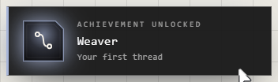
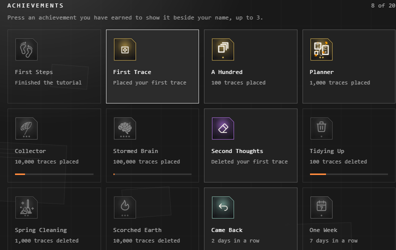

# Achievements

Small awards for using the Atrium. When you earn one, a card slides in at the
right edge of the screen, with a sound if interface sounds are on.

## All 20

| Achievement | Earned by |
|---|---|
| **First Steps** | Finishing the tutorial |
| **First Trace** | Placing your first trace |
| **A Hundred** | 100 traces placed |
| **Planner** | 1,000 traces placed |
| **Collector** | 10,000 traces placed |
| **Stormed Brain** | 100,000 traces placed |
| **Second Thoughts** | Deleting your first trace |
| **Tidying Up** | 100 traces deleted |
| **Spring Cleaning** | 1,000 traces deleted |
| **Scorched Earth** | 10,000 traces deleted |
| **Came Back** | 2 days in a row |
| **One Week** | 7 days in a row |
| **One Month** | 30 days in a row |
| **One Year** | 365 days in a row |
| **Weaver** | Your first thread between two traces |
| **Spider** | 100 threads |
| **Colourist** | 100 colours taken from the screen with the dropper |
| **Scribbler** | 100 drawings |
| **Off the Shelf** | 10 templates placed |
| **It's a Boy!** | Making a template of your own |

## See them

Your **Profile** shows all 20: earned ones lit in their colour, the rest grey,
with a bar for how far along you are.

Press one you've earned to show it beside your name, up to 3. Others see them
on your profile, if you let them find it. See [Profile and account](profile-and-account.md).

## How they're counted

- A trace counts when it's made, not each time it's moved or saved.
- A day counts the first time you open the Atrium that day. A streak's
  achievement stays once earned, however the streak ends.
- What you do on several devices is counted on your account: the higher count
  of each wins, so nothing is counted twice.
- They're for fun, not proof: there are no leaderboards.

## Related

- [Profile and account](profile-and-account.md): where they're shown.
- [Connections](../arranging/connections.md): threads, for Weaver and Spider.
- [Templates](../bringing-things-in/templates.md): for Off the Shelf and It's a Boy!
- [Colours and your palette](../making-it-look-right/colours-and-palette.md): the dropper, for Colourist.
