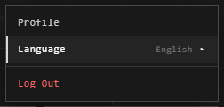

# Language and theme

## Language

Press your name at the top right > **Language**, or **Profile** > **Language**.

English, Español, Português (Brasil), Português (Portugal), Français, Deutsch,
Italiano, Русский, 中文, 日本語 and 한국어.

The whole app changes at once, atriums included. "Trace" stays "trace" in
every language: it's the Atrium's own word.

The help is in English for now, whatever the language.

## Light or dark

The sun and moon button, at the top right on Home and in every atrium,
switches the interface between light and dark. It's yours alone: everyone
else sees what they chose.

An atrium's theme is light or dark too, and picking one in **Atrium Themes**
switches the interface with it. See [Atrium themes](../making-it-look-right/atrium-themes.md).

## Related

- [Profile and account](profile-and-account.md): your other settings.
- [Atrium themes](../making-it-look-right/atrium-themes.md): the room itself.
- [User Preferences](preferences.md): how the atrium behaves for you.
