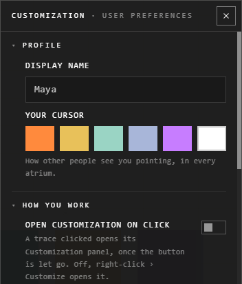

# User Preferences

Open **User Preferences** on the view bar, inside any atrium.

Your display name and cursor colour belong to your account: they change when
you press **Save Changes**. Everything else is this device's own and takes
effect at once.

## Profile

| Setting | What it does |
|---|---|
| **Display name** | The name others see. Once every 15 days |
| **Your cursor** | The colour others see you pointing with, in every atrium |

## How you work

| Setting | What it does |
|---|---|
| **Open Customization on click** | Clicking a trace opens its Customization panel. Off: right-click > **Customize** |
| **Auto-save** | Changes save themselves after a while instead of waiting for **Save** |
| **Saves after** | With auto-save: 10 to 60 minutes. On desktop, also **constantly** |
| **Ask before deleting** | Deleting a trace asks first |
| **Steps you can undo** | 1 to 100 |
| **Shape for batch placement** | Several files dropped at once are laid out in a **square** or a **circle** |

## Moving around

| Setting | What it does |
|---|---|
| **Zoom speed** | How far one notch of the wheel, or a pinch, zooms |

## What you see

| Setting | What it does |
|---|---|
| **Point to off-screen traces** | Arrows at the edge, with how far away each is |
| **Label each trace's type** | Every trace shows its type, selected or not |
| **Fade traces near the edge** | Traces fade softly as they leave your view |

## People in the room

| Setting | What it does |
|---|---|
| **Hide My Name Tag** | No name above your own cursor |
| **Hide Others' Name Tags** | No names above other people's cursors |
| **Hide Others' Cursors** | Other people's cursors don't show at all |
| **Hide My IP Address** | Connect through a relay, so others here can't see your IP address |

With **Hide My IP Address** on and the relay unavailable, your cursor reaches
others every few seconds instead of live.

## Sound

| Setting | What it does |
|---|---|
| **Interface sounds** | Soft sounds as you place, delete, save, undo. Off at first on the web, on in the desktop app |
| **Spatial sound** | A playing video or sound is heard from where it is, quieter as it leaves the screen |

**Interface sounds** is the same switch as the one on your Profile page.

## Animations

| Setting | What it does |
|---|---|
| **Drag feel** | A dragged trace trails the pointer and settles with a small bounce. 0 moves it rigidly |
| **Floating traces** | Traces drift gently on their own. 0 keeps them still |
| **Throw momentum** | A thrown trace glides on, then settles. 0 puts it where you let go |

## Related

- [Undo and saving](../arranging/undo-and-saving.md): Save, Don't Save and auto-save in full.
- [Drop and paste](../bringing-things-in/drop-and-paste.md): what batch placement lays out.
- [Accounts](../getting-started/accounts.md): your username and display name.
- [The Customization panel](../making-it-look-right/customization-panel.md): a trace's own settings.
