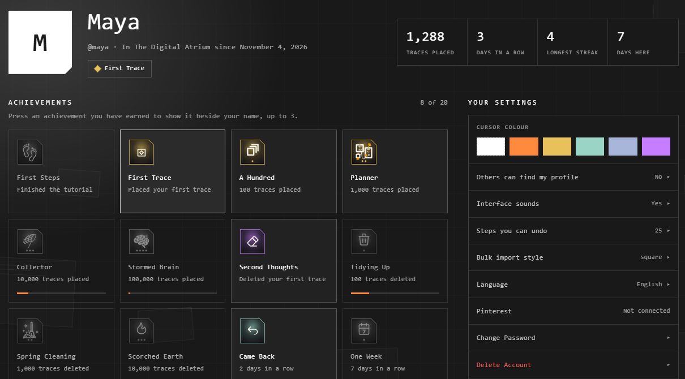

# Profile and account

Press your name at the top right > **Profile**.

## You

| Part | What it is |
|---|---|
| Your picture | **Add a picture**, **Change picture** or **Remove picture**. Drag and zoom to crop it |
| Your name | Your display name, and your @username under it |
| Beside your name | Up to 3 achievements you choose to show |
| The figures | Traces placed, days in a row, your longest streak, days here |

## Achievements

There are 20, earned by what you do: your first trace, a hundred traces, coming
back on two days in a row, and more. One not earned yet shows how far along you
are.

Press one you've earned to show it beside your name, up to 3.

## Other people's profiles

Type a username in **Find someone by username**, at the top. You see their
name, picture and achievements, if they've let others find them. **Back to
mine** brings yours back.

Others can find yours only if you say so: the page asks once, and **Others can
find my profile** changes it any time.

## Your settings

| Setting | What it does |
|---|---|
| **Cursor colour** | How others see you pointing, in every atrium |
| **Others can find my profile** | Whether your profile comes up in a search |
| **Interface sounds** | The same switch as in User Preferences |
| **Steps you can undo** | 1 to 100 |
| **Bulk import style** | Several files dropped at once: a square or a circle |
| **Language** | The app's language. See [Language and theme](language-and-theme.md) |
| **Pinterest** | Connect or disconnect. See [Importing from Pinterest](../bringing-things-in/pinterest-import.md) |
| **Change Password** | Your current password, then the new one twice. Email accounts only |
| **Delete Account** | See below |
| **Log Out** | Sign out on this device |

## Delete your account

**Delete Account** deletes your account, your profile and the atriums you own,
for good. What you made in other people's atriums stays, with no name on it.

First type your username to confirm. Then:

- A Google account confirms with Google. Atriums kept in your Google Drive stay there, yours.
- An email account confirms with its password.
- An older account confirms with a 6-digit code sent to its email. It lasts 10 minutes.

It can't be undone.

## Related

- [Accounts](../getting-started/accounts.md): signing in, usernames and display names.
- [User Preferences](preferences.md): the settings inside an atrium.
- [Language and theme](language-and-theme.md): the app's language, light and dark.
