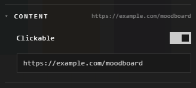

# Clickable traces

Any trace can open a link when it's clicked: a shape as a button, a picture
that leads to its source, a note that points to a page.

## Make one

1. Right-click the trace > **Customize**.
2. Under **Content**, turn on **Clickable**.
3. Type or paste the link.

Now a click on it opens the link.

## Change or stop it

| You want | Do this |
|---|---|
| A different link | Change it under **Content** |
| Move it | Drag it: a drag doesn't open the link |
| Select it without opening the link | **Shift**+click it (or **Ctrl** or **Alt**) |
| The link off, from the canvas | Point at it, then press the small button that appears: **Stop opening the link when clicked** |
| The link off, from the panel | Turn off **Clickable** |

The small button shows to those who can edit the atrium, on a trace big enough
to hold it.

## Good to know

- An embed has its own link already: see [Embeds and links](../bringing-things-in/embeds-and-links.md).
- A thread from one trace to another isn't a link: see [Connections](connections.md).

## Related

- [Embeds and links](../bringing-things-in/embeds-and-links.md): showing a web page itself.
- [Connections](connections.md): threads between traces.
- [The Customization panel](../making-it-look-right/customization-panel.md): its Content section.
