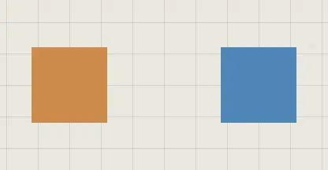

# Connections

A connection is a thread from one trace to another. Move either trace and the
thread follows.

## Connect traces

| You want | Do this |
|---|---|
| A thread between two traces | Press **C**, then drag from one trace to the other |
| The same, by clicking | Press **C**, click one trace, then the other |
| Threads from several to one | Select them, right-click > **Connect to…**, then click the one they go to |
| Stop connecting | Press **C** again, or **Esc** |

**Connect** stays on until you pick another tool, so you can draw several
threads in a row. There's one thread per pair of traces: connecting two
that are already connected does nothing.

## Change a thread

Click a thread to select it, then right-click it for its menu. **Shift**+click
adds more threads to the selection: the menu changes them all.

| Setting | Choices |
|---|---|
| **Colour** | Any colour, or **Match the trace's border** |
| **Thickness** | A slider |
| **Line** | **Curved**, **Elbow** or **Straight** |
| **Ends** | **At the border**, or **At the centre** |
| **Arrow** | **No arrow**, **Towards the trace it connects to**, **Towards the trace it comes from**, **Both ways** |
| **Label** | A few words on the thread, its **Label size**, and **Show only on hover** |

An **Elbow** thread turns at right angles. Drag its middle run to move the bend.

## Select and delete

| You want | Do this |
|---|---|
| One thread | Click it |
| Several | **Shift**+click each, or **Shift**+drag an area across them |
| Gone | **Delete**, or **Delete** in its menu |

An area or a lasso selects the threads it crosses, along with the traces, and
each new area adds to the selection.

## Good to know

- A thread's colour, when you haven't chosen one, follows the border colour of the trace it starts from.
- Deleting a trace deletes its threads. **Ctrl+Z** brings both back.
- A thread is drawn just under the lower of its two traces.
- Threads are saved with the atrium, exported in an .atrium file, and come back with an import.

## Related

- [The quick bar](../bringing-things-in/quick-bar.md): **Connect** and its key.
- [Selecting](selecting.md): areas and lassos take threads too.
- [Templates](../bringing-things-in/templates.md): the mind map and flowchart come with their threads.
- [Undo and saving](undo-and-saving.md): threads wait for **Save** like traces.
