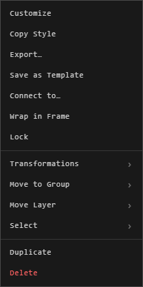

# Copy, duplicate and delete

| You want | Do this |
|---|---|
| Copy what's selected | **Ctrl+C** |
| Paste it where the pointer is | **Ctrl+V** |
| A copy beside the original | Right-click > **Duplicate** |
| A whole group copied | In the Layers panel, right-click the group > **Duplicate Group** |
| Delete what's selected | **Delete** or **Backspace**, or right-click > **Delete** |
| Delete several | Right-click > **Delete Selected (3)** |

## Copy and paste

What you copy comes along with its look, its connections between the copied
traces, and, for a frame, everything it holds. Paste in another atrium and it
comes there too.

A whole group copied comes as a new group above the first. A trace copied on
its own stays in its original's group.

## Delete

Every delete is a step: **Ctrl+Z** brings it back, and nothing is gone for
good until you save.

With **Ask before deleting** on, you're asked first. Turn the question off in
that dialog, or back on in **User Preferences** > **How you work**.

Deleting a group in the Layers panel asks whether to delete everything in it.
See [Groups and the Layers panel](groups-and-layers.md).

## Copy something else

| Right-click > | Copies |
|---|---|
| **Copy Text** | A text trace's words |
| **Copy Embed Link** | An embed's address |
| **Copy Style** | Its look, to paste on others. See [Colours and your palette](../making-it-look-right/colours-and-palette.md) |

## Good to know

- Pasting needs edit rights in the atrium you paste into.
- In a Google Drive atrium, the owner and admins can bring back what anyone deleted. See [Google Drive atriums](../working-together/drive-atriums.md).

## Related

- [Selecting](selecting.md): choosing what to copy or delete.
- [Undo and saving](undo-and-saving.md): taking a delete back.
- [Stacking order](stacking-order.md): where copies land in the stack.
