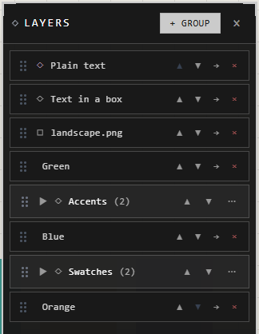

# Groups and the Layers panel

A group ties traces together: select one and you select them all, move one and
they all move. The **Layers** panel lists the groups and traces in their
stacking order. What's higher in the list is drawn in front.

Open it with **Layers** on the view bar.

## Make and undo groups

| You want | Do this |
|---|---|
| A group from what's selected | **Ctrl+G**, or right-click > **New Group…** |
| A trace into an existing group | Right-click it > **Move to Group** |
| A trace out of its group | Right-click it > **Ungroup**, or **Ctrl+Shift+G** |
| Every trace out, keeping the group | In the panel, the group's menu > **Empty Group** |
| A copy of a group and what's in it | The group's menu > **Duplicate Group** |

A trace taken out of a group lands just above it in the list.

## Change the order

| You want | Do this |
|---|---|
| Move a group or a trace up or down | Drag its grip in the panel |
| Right to the front or the back | Right-click > **Move to Top** or **Move to Bottom** |
| To the front or back inside its group | Right-click > **Move to Top of Group** or **Move to Bottom of Group** |

Groups and loose traces share one stack, so a loose trace can sit between two
groups.

## Find, lock, select

| You want | Do this |
|---|---|
| See a trace on the canvas | In the panel, its row > **Go to trace** |
| See all of a group | The group's menu > **Go to Group**: the view frames everything in it |
| Every trace in a group | Click the group's name, or its menu > **Select All Traces** |
| Stop a trace being picked or dragged by accident | **Lock** on its row |
| A whole group locked, or unlocked | The group's menu > **Lock All** or **Unlock All** |

A locked trace stays where it is on the canvas until you unlock it.

## Delete a group

The group's menu offers two ways:

- **Ungroup**: the group goes; its traces stay where they are, out of any group.
- **Delete + 5 Traces**: the group and everything inside it.

## Good to know

- Changes in the Layers panel wait for **Save** like any change: **Don't Save** takes them back, and so does **Ctrl+Z**. See [Undo and saving](undo-and-saving.md).
- Groups can't go inside other groups.
- A group has no box or title of its own. For a visible area with a title, use a frame.
- New traces and new groups go on top of everything.

## Related

- [Frames](frames.md): a titled box that holds traces. Use a frame for a visible area, a group for traces that should always move as one.
- [Selecting](selecting.md): **Ctrl**+click picks one trace inside a group.
- [Undo and saving](undo-and-saving.md): how panel changes are kept.
- [Move, resize and rotate](move-resize-rotate.md): a group moves and turns as one.
- [Keyboard shortcuts](../moving-around/keyboard-shortcuts.md): **Ctrl+G** and **Ctrl+Shift+G**.
