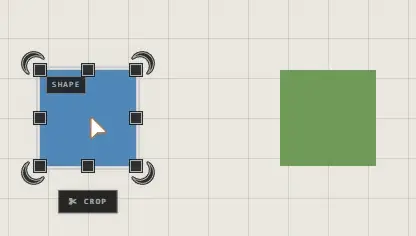
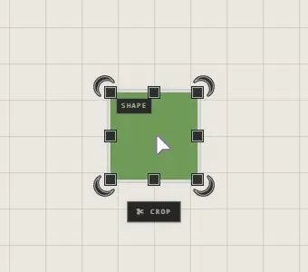

# Move, resize and rotate

Select a trace, then drag it, or drag its handles. Several selected traces move
together.

## Move, resize, rotate

| You want | Do this |
|---|---|
| Move it | Drag the trace |
| Line it up with the traces beside it | Hold **Shift** while you drag |
| Make it bigger or smaller | Drag a handle on its edge or corner |
| Line its edge up with a neighbour's | Hold **Shift** while you drag a handle |
| Turn it | Drag the rotate handle |
| Turn it in clean steps | Hold **Shift** while you turn: **SNAP 5°** |

While **Shift** is held, guide lines show what the trace is lining up with. With
no neighbour close enough on a side, the trace snaps to the canvas grid on that
side instead.

## Put it back

| You want | Do this |
|---|---|
| No rotation | Right-click it > **Reset Rotation** |
| Its own proportions, unstretched | Right-click it > **Reset Aspect Ratio** |
| The last change undone | **Ctrl+Z** |

## Good to know

- A rotated trace doesn't snap its edges while you resize it: its edges aren't straight up and down.
- Moves and resizes wait for **Save** like any other change. See [Undo and saving](undo-and-saving.md).
- Frames can't be rotated.
- Resizing an arranged frame by hand sets the height it keeps. See [Frames](frames.md).

## Related

- [Selecting](selecting.md): select several traces to move them together.
- [Frames](frames.md): moving a frame moves what's inside it.
- [Groups and the Layers panel](groups-and-layers.md): a group moves as one.
- [Undo and saving](undo-and-saving.md): taking a change back.
- [Keyboard shortcuts](../moving-around/keyboard-shortcuts.md): every key.
