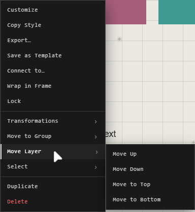

# Stacking order

Where traces overlap, the one higher in the stack is drawn on top. Groups and
traces in no group share one stack, so a loose trace can sit between two
groups. Inside a group, its traces have an order of their own.

A new trace goes on top of everything.

## Move a trace in the stack

Right-click it > **Move Layer**:

| Choose | It goes |
|---|---|
| **Move Up** | Over the one above it |
| **Move Down** | Under the one below it |
| **Move to Top** | Over everything; in a group, **Move to Top of Group** |
| **Move to Bottom** | Under everything; in a group, **Move to Bottom of Group** |

The same four are buttons under **Order** in its Customization panel's
**Arrange** section, and in the panel's footer.

## In the Layers panel

The Layers panel lists the stack, top first. Drag a trace or a group up or
down the list to move it; drop it on a group to put it inside. See
[Groups and the Layers panel](groups-and-layers.md).

## Good to know

- Several selected traces move together: right-click one of them, or use the panel's footer.
- A trace alone in its group has nothing to move past: **Move Layer** doesn't show.

## Related

- [Groups and the Layers panel](groups-and-layers.md): the stack as a list.
- [Frames](frames.md): boxes that hold traces.
- [The Customization panel](../making-it-look-right/customization-panel.md): its Arrange section.
