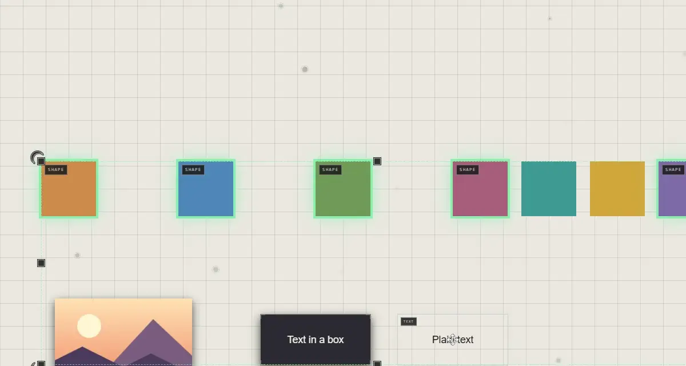

# Tidying up

Select the traces, right-click one > **Reorganize Selected (6)**, and choose:

| Choose | They're packed |
|---|---|
| **Square** | Into a rectangular block |
| **Circle** | Into a round cluster |

They're packed around the middle of where they were, close together, each
keeping its size.

It's one step: **Ctrl+Z** puts them back where they were.

## Good to know

- Reorganize ignores **Shape for batch placement** in User Preferences: that one sets how several dropped files arrive.
- For a frame that keeps what it holds in order as it changes, use **Arrange Automatically** on the frame. See [Frames](frames.md).
- Other traces aren't moved out of the way: the packed ones may sit over them.

## Related

- [Selecting](selecting.md): picking the traces to tidy.
- [Frames](frames.md): boxes that arrange what they hold.
- [Drop and paste](../bringing-things-in/drop-and-paste.md): several files arriving at once.
