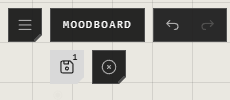

# Undo and saving

What you change in an atrium waits until you save it. The save button, under
the atrium's name, shows how many changes are waiting; pointed at, it says
**Save changes (1)**. **Don't Save** is beside it.

## Save, or take it back

| You want | Do this |
|---|---|
| Keep your changes | Press the save button, or **Ctrl+S** |
| Throw away everything since the last save | Press **Don't Save**, then **Confirm Discard** |
| Undo one step | **Ctrl+Z** |
| Redo it | **Ctrl+Shift+Z** |

After saving, the button says **Saved**. If it says **Not saved — retry**, the
save didn't get through: press it again.

Undo still works after you save: **Ctrl+Z** goes back past a save, and the next
save keeps the undone state. **Don't Save** clears the undo history, since
everything it could undo is gone.

## Leaving with unsaved changes

Leaving the atrium or closing the app with changes waiting asks first:

- **Save and Leave** saves, then leaves.
- **Leave without saving** drops the changes.

Nothing is saved without you choosing it, unless Auto-save is on.

## Auto-save

Turn on **Auto-save** in your preferences, and changes save themselves after the
time you set, instead of waiting for **Save**.

| | Web | Desktop |
|---|---|---|
| Off or on | Off at first | Off at first |
| Saves after | 10 to 60 minutes (10 at first) | 0 to 60 minutes (2 at first) |
| 0 minutes | Not available | **Constantly**, moments after each change |

With Auto-save on, **Don't Save** has little left to take back.

## How far back

**Steps you can undo**, in your preferences, sets how many actions **Ctrl+Z** can
undo inside an atrium: 1 to 100.

## Good to know

- Everything waits for **Save**: new traces, changes, deletions, groups and their order, templates placed.
- Undo history lasts while the atrium is open. Leave it, or reload, and it starts again.
- In an atrium shared live, your undo takes back your own changes, not other people's.
- Auto-save is set per device: on one computer, off on another.

## Related

- [Groups and the Layers panel](groups-and-layers.md): groups, and the order things are drawn in.
- [Keyboard shortcuts](../moving-around/keyboard-shortcuts.md): **Ctrl+S**, **Ctrl+Z** and the rest.
- [Preferences](../account-and-settings/preferences.md): Auto-save and Steps you can undo.
- [Export](../keeping-and-moving/export.md): keep a copy of the whole atrium as a file.
- [Storage and limits](../keeping-and-moving/storage-and-limits.md): when a save fails because there's no room.
