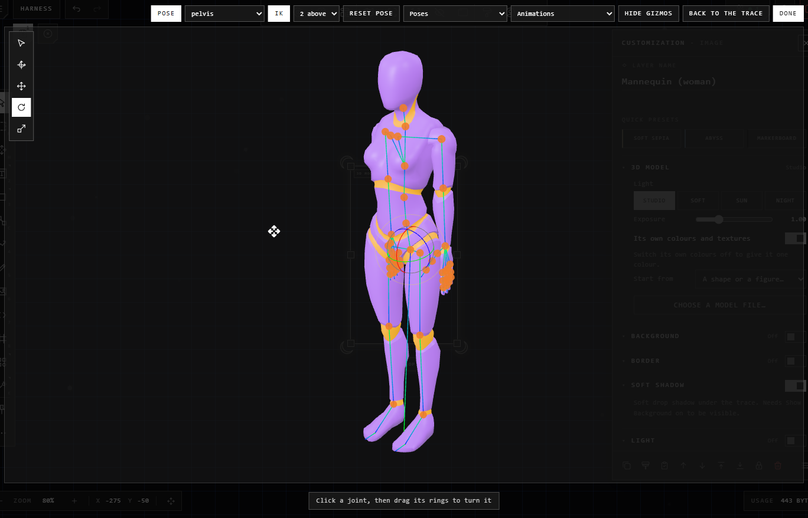
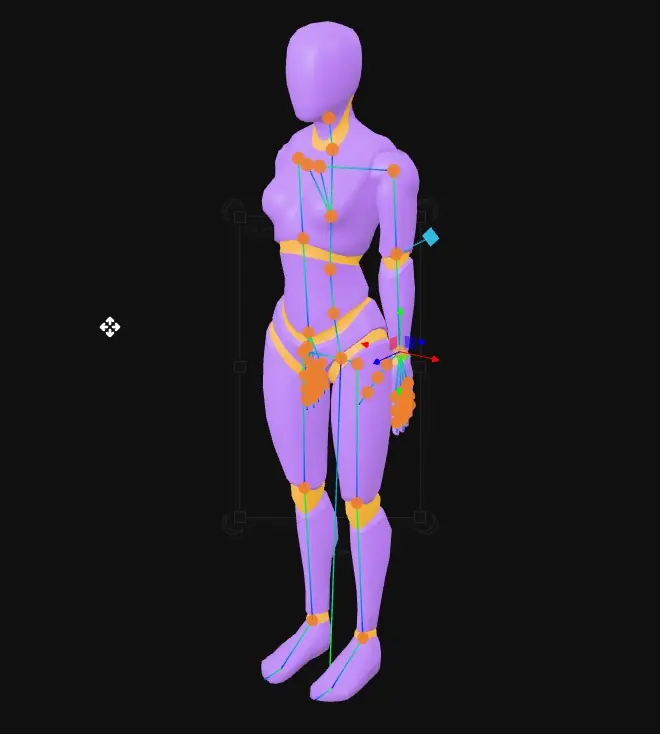
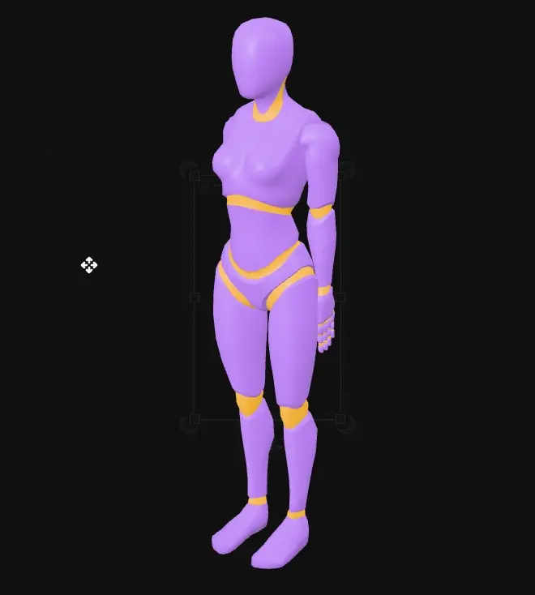
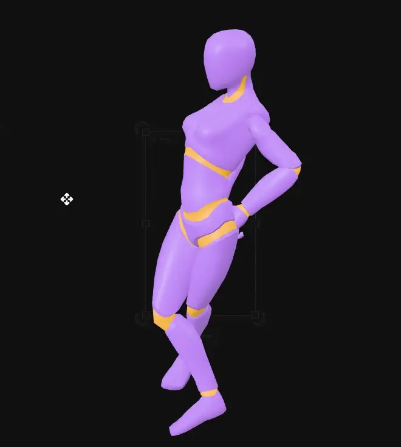
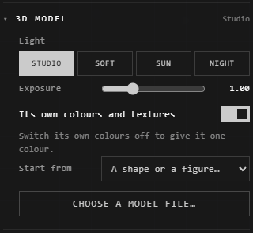

# 3D models

A 3D model is a picture of the model, with nothing behind it, that keeps the
model itself: open it to turn it, pose it, or play an animation, and the
picture is made again from there.

## Place one

| You want | Do this |
|---|---|
| Your own model | Drop its file on the canvas |
| One to start from | **Other** > **3D model** on the quick bar (or right-click the canvas > **3D model**): a cube |
| Another in its place | Customize it > **3D model** > **Choose a model file…** |
| A shape or a figure | Customize it > **3D model** > **Start from**: **Cube**, **Sphere**, **Cylinder**, **Cone**, or a **Mannequin** (man or woman) |

The mannequins are by Quaternius (free to use: CC0), standing, ready to pose.

Files: **.glb**, **.gltf**, **.fbx** (7.0 or newer), **.obj**, **.stl**, **.dae**
(Collada), **.vrm** (an avatar: VRoid and the like).

**Its textures:** drop them with it, all at once (the .png/.jpg textures, an
.obj's **.mtl**, a .gltf's **.bin**). They're read into the model, kept with it
as one **.glb**, and not placed as pictures of their own.

## Turn it

Double-click it, press **Turn in 3D** on it when it's selected, or right-click
it > **Turn in 3D**. It turns in its box; what dragging does shows at the foot of
the screen.

| You want | Do this |
|---|---|
| Turn it | Drag on it |
| Move it in its box | Right-drag (or **Shift**+drag) |
| Nearer or further | Scroll on it |
| Your last move back, or on again | **Ctrl+Z**, **Ctrl+Shift+Z** |
| A picture of this view, beside it | **Snapshot** |
| Back to how it arrived | **Reset view** |
| Everything else: posing, moving its parts, poses, animations | **More tools** |
| Keep this view | **Escape**, or click anywhere else |

Let go of it, and its picture becomes the new view: one step, **Ctrl+Z** takes
it back. Only one model turns at a time. Made wider or taller, a model's box
shows the model as it is, never stretched.

## More tools

**More tools** takes it out of its box onto the whole window, with all of its
tools. **Back to the trace**, **Escape** or a click beside it puts it back in its
box, still turning; **Done** keeps what you did and lets go.

### Move, turn or scale it

The strip of tools down its left:

| Tool | What dragging does |
|---|---|
| **View** (the arrow) | Turns the view: nothing on it changes |
| **Move and rotate** | The arrows outside move it, the rings inside turn it |
| **Move** | The arrows (one axis), a square (a plane) or the middle (freely) |
| **Rotate** | The rings: each turns about one axis, the middle turns freely |
| **Scale** | Its handles |

With any tool but View, they work on the whole model, or on the part you click
(a model of several pieces: the part list shows them too). **Reset parts** puts
every part back as it came.

The handles grow and shrink as you come nearer or go further, as the model does.
**Hide gizmos** hides them to see the model clean (joints still show, and can
still be chosen); **Show gizmos** brings them back.

### Pose it

A model with a skeleton (a rigged character, an armature) shows **Pose**. Press
it: its joints show as dots, and the tools work on the joint you click (or pick
from the bone list). A person's hips are chosen first; a person's hair and
clothes' bones aren't dotted, but are in the list.

**IK** (on at first): moving a joint turns the bones above it, so it can get
there; a hand dragged bends the elbow and the shoulder, and nothing comes apart.
How many bones follow: the list beside it (**2 above** by default). With IK off,
**Move** moves the joint alone.

With **2 above** (an arm, a leg), a blue **diamond** shows: the **pole**. The
knee or elbow bends toward it. Click it, then drag its arrows to set which way
the limb bends; the hand or foot stays where it is. A straight knee starts
bending forward, a straight elbow back.

**Reset pose** puts it back at rest. **Ctrl+Z** and **Ctrl+Shift+Z** step through
your changes.

### Ready-made poses and animations

A model whose skeleton is a person's has **Poses** and **Animations**: the
mannequins, Mixamo characters, VRM avatars, and Unreal, Blender (Rigify) and
Character Creator rigs. Its bones are found by their names (hips, spine, upper
arm, forearm, thigh, calf, fingers...), or, in a VRM, by what the file says; a
skeleton named some other way has none, but poses by hand.

| List | What's in it |
|---|---|
| **Poses** > **Basic** | Standing, T-pose, A-pose |
| **Poses** > **Standard** | Idle, talking, arms folded, on the phone, sitting, kneeling, crouching, walking, running, waving, stretching, reclining, yoga |
| **Poses** > **Expressive** | Hand on hip, weight on one leg, catwalk, strutting, graceful, shy, celebrating, sad, hand in hair, dance poses |
| **Poses** > **Action** | Superhero landing, aiming, fists up, hook, punch, kicks, guard, karate stance, blocking, sword, spells, ninja, throwing, sliding |
| **Animations** | Everyday, Dance, Expressive and Action: walks, idles, salsa, Charleston, boxing, karate, swordplay and more |

An animation plays round (or to its end); **Pause** holds it where it is, and
that's its pose then: change it, or **Done** to keep it. **Play** goes on from
there. Taking a pose, **Reset pose**, or dragging a joint pauses it too.

The poses and animations are frames of Quaternius's animations (free to use:
CC0) and of motion capture from Carnegie Mellon University's database
(mocap.cs.cmu.edu): people performing them.

**Done** keeps the pose with the view: one step, **Ctrl+Z** takes it back. Its
picture, and any new one made by its light or colour, shows it posed.

## Light and colour

Customize it, then the **3D model** section:

| Control | What it does |
|---|---|
| **Light** | **Studio**, **Soft**, **Sun** or **Night** (a cold light from behind it) |
| **Exposure** | Brighter or darker; kept when you let go |
| **Its own colours and textures** | On (at first), its parts' own colours and pictures show; off, it's all one colour |
| **Colour** | With its own colours off: that one colour (grey until you pick one) |
| **Start from** | A shape or a mannequin in its place |
| **Choose a model file…** | Another model in its place (with its textures, chosen together) |

Each change makes its picture again: one step, **Ctrl+Z** takes it back. While
it's turning, you see the change there too.

## Good to know

- A .gltf missing its .bin can't be read: drop the .bin with it, or export it as **.glb**, one file.
- A Draco-compressed model can't be read yet.
- An FBX older than 7.0 (some Mixamo downloads are 6.1) can't be read: download it again as **FBX for Unity** or **Collada (.dae)**, or export it as **.glb**.
- A VRM shows toon-shaded, outlined, as its maker made it. While it's open, its hair and clothes swing as you pose it (its physics); its picture shows them at rest, hanging. Its expressions don't play.
- An .stl has no colours of its own: it's grey, its own colours off; give it a **Colour**.
- A model's own animations don't play: it shows its rest pose, or the pose you give it.
- Everything else a picture can do (crop, flip, export) works on it, from its picture. See [Pictures](pictures.md).

## Related

- [Pictures](pictures.md): what any picture can do.
- [Drop and paste](drop-and-paste.md): bringing files in.
- [EXR pictures and grading](exr-grading.md): another file kept beside its picture.
- [Customization panel](../making-it-look-right/customization-panel.md): where its light and colour are.
