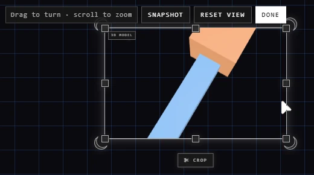

# 3D models

Drop a 3D model on the canvas, or pick one with **Other** > **3D model** on the quick
bar. It arrives as a still picture of the model with nothing behind it, and
keeps the model file so you can turn it.

Files: **.glb**, **.gltf** (one file, everything inside it), **.fbx**, **.obj**,
**.stl**.

## Turn it

Double-click it, press **Turn in 3D** on it when it's selected, or right-click
it > **Turn in 3D**.

| You want | Do this |
|---|---|
| Turn it | Drag on it |
| Nearer or further | Scroll on it |
| A picture of this view, beside it | **Snapshot** |
| Back to how it arrived | **Reset view** |
| Keep this view | **Done**, **Escape**, or click anywhere else |

Done, the model's picture becomes the new view: one step, **Ctrl+Z** takes it
back. Only one model turns at a time.

## Good to know

- A .gltf that keeps its parts in other files (a .bin, textures) can't be read: export it as **.glb**, one file.
- A Draco-compressed model can't be read yet.
- An .obj or .fbx shows its own colours and textures when they're inside the file; an .obj without them is grey.
- A model shows its rest pose. Animations don't play.
- Everything else a picture can do (crop, flip, its Look, export) works on it, from its picture. See [Pictures](pictures.md).

## Related

- [Pictures](pictures.md): what any picture can do.
- [Drop and paste](drop-and-paste.md): bringing files in.
- [EXR pictures and grading](exr-grading.md): another file kept beside its picture.
