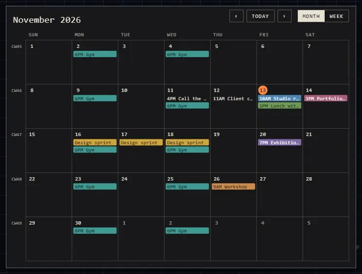

# Calendars

Drop an **.ics** file on the canvas, or pick one with **Other** > **Calendar** on
the quick bar. It's placed as a calendar of this month, named after the
calendar inside the file.

Google Calendar, Outlook and Apple Calendar all export one: look for
**Export** or **Download** in the calendar's settings.

| You want | Do this |
|---|---|
| The next or last month (or week) | **›** or **‹** |
| Back to now | **Today** |
| Hours, a week at a time | **Week** (and **Month** to go back) |
| Its colours | The Customization panel: its **Background** is the calendar's paper, its text follows |

**Month** or **Week** is kept with the calendar; **Ctrl+Z** takes the switch
back. Which month you've paged to is yours alone, and it opens on today's.

## Good to know

- Repeating events, a repeat moved or cancelled, and whole-day events show as in the calendar app.
- Times are shown in your computer's time zone.
- A day with more events than fit says **+N**; switch to **Week** to see them all.
- The calendar shows the file as it was when dropped: drop the new file to bring changes in.
- An export of the atrium (PNG, SVG) shows the calendar's month or week of today.

## Related

- [Drop and paste](drop-and-paste.md): bringing files in.
- [Spreadsheets and charts](spreadsheets-and-charts.md): another file read in the atrium.
