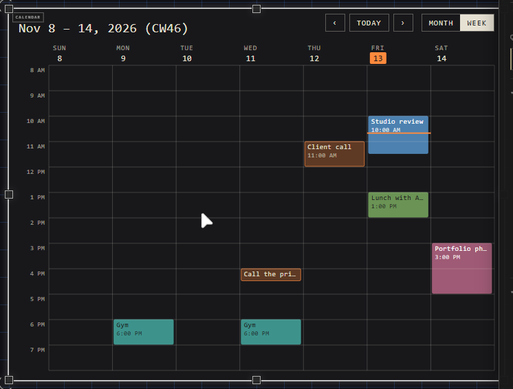
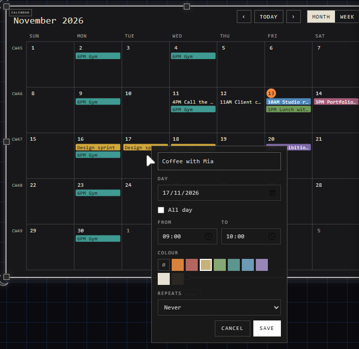
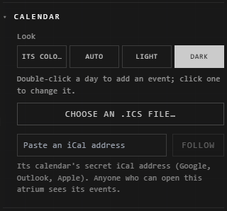

# Calendars

A calendar shows a month or a week of events, numbered by week, and pages
through them.

## Place one

| You want | Do this |
|---|---|
| An empty one, to fill in here | **Other** > **Calendar** on the quick bar (or right-click the canvas > **Calendar**): this month |
| One from a calendar app | Drop its **.ics** file on the canvas: placed with its events, named after its calendar |
| One that keeps up with a calendar app | Paste its iCal address on the canvas (see [Follow a calendar](#follow-a-calendar)) |

Google Calendar, Outlook and Apple Calendar all export an .ics file: look for
**Export** or **Download** in the calendar's settings.

## Page through it

| You want | Do this |
|---|---|
| The next or last month (or week) | **›** or **‹** |
| Back to now | **Today** |
| Hours, a week at a time | **Week** (and **Month** to go back) |

Paged back to this month, **Week** shows this week. **Month** or **Week** is kept
with the calendar; **Ctrl+Z** takes the switch back. Which month you've paged
to is yours alone, and it opens on today's.

Weeks are numbered as calendars in Europe number them: beside a week's dates
(**CW46**), and down the left of a month.

## Your own events

| You want | Do this |
|---|---|
| An event | Double-click its day (in **Week**, its hour) |
| To change it | Click it, change it, **Save** |
| To take it away | Click it, **Delete** |
| One that repeats | **Repeats**: every day, week, month or year |
| A colour for it | One of its **Colour** swatches: its words turn black or white, whichever reads |

Each change is one step: **Ctrl+Z** takes it back. Changing an event that
repeats changes every repeat.

## Its look and its file

Customize it, then the **Calendar** section:

| Control | What it does |
|---|---|
| **Look** | **Auto** (light or dark, as you have the atrium; new calendars are), **Light**, **Dark**, or **Its colours** (its Background and text colour) |
| **Choose an .ics file…** | That file's events in its place |
| **Paste an iCal address** > **Follow** | Follows that calendar (below) |

## Follow a calendar

Paste its **iCal address** on the canvas (**Ctrl+V**), or in the Calendar section
> **Follow**: the calendar follows it, and shows it as it is now each time you
open the atrium. **↻** reads it again at once.

| Calendar | Where its address is |
|---|---|
| Google Calendar | Settings > your calendar > **Secret address in iCal format** |
| Outlook | Settings > Calendar > Shared calendars > **Publish a calendar** > the ICS link |
| Apple Calendar | Share the calendar as **Public Calendar**: its webcal:// link |

If it can't be followed, the Calendar section says why:

| It says | Do this |
|---|---|
| Not shared at that address | Google's **Public address** works only for a calendar made public: use the **Secret address in iCal format**, or make the calendar public first |
| Not a calendar | The address gives a web page: copy the iCal (.ics) address, not the calendar's page |
| Didn't answer | Check the address, or try again later |

Anyone who can open the atrium sees the calendar's events. To stop: the Calendar
section > **Stop following**; it keeps the events it last showed.

## Good to know

- Repeating events, a repeat moved or cancelled, and whole-day events show as in the calendar app.
- Times are shown in your computer's time zone.
- A day with more events than fit says **+N**; switch to **Week** to see them all.
- A dropped file shows the calendar as it was: drop the new file, or follow its address, to bring changes in.
- A calendar that follows an address shows only that calendar's events: change them in its calendar app.
- An export of the atrium (PNG, SVG) shows the calendar's month or week of today.

## Related

- [Drop and paste](drop-and-paste.md): bringing files in.
- [Spreadsheets and charts](spreadsheets-and-charts.md): another file read in the atrium.
- [Customization panel](../making-it-look-right/customization-panel.md): where its look is.
