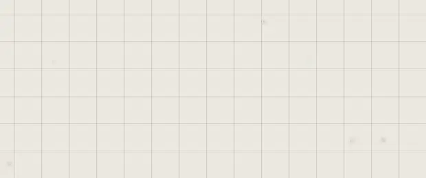

# Drawing

**Draw** (**5**) draws freehand on the canvas. Everything you draw in one go
becomes one trace, a drawing, that you can move, resize and draw on again.

## Draw

| You want | Do this |
|---|---|
| Start drawing | Press **5**, or **Draw** on the quick bar |
| A stroke | Click and drag |
| Rub out | Press **E** for the **Eraser**, then drag over what to remove |
| Take back a stroke | **Ctrl+Z**; bring it back with **Ctrl+Shift+Z** |
| Stop drawing | **Esc**, or **Exit drawing** |

Strokes wait for **Save** like any change: leave without saving, and the drawing goes.

## Brushes

The **Freehand Draw** panel holds the brush and how it draws:

| Setting | Choices |
|---|---|
| **Brush** | **Pen**, **Pencil**, **Marker**, **Airbrush**, **Calligraphy**, or one of your own |
| **Colour** | Any colour, your palette's included |
| **Width** | How thick the stroke is (the eraser's is its **Size**) |
| **Smooth** | How much a shaky hand is evened out |
| **Hardness** | How sharp the stroke's edge is |

**Import a brush** makes a brush from a picture: a PNG with a transparent
background, or a dark shape on white. It's kept in your vault.

## Afterwards

| You want | Do this |
|---|---|
| Draw on it again | Right-click it > **Edit Drawing** |
| Each stroke a trace of its own | Right-click it > **Split into Strokes**: they're put in a group named after the drawing |
| One flat picture | Right-click > **Rasterize**: its strokes can no longer be edited |
| Its colour changed | Select it and click a colour in your palette |

## Make it move

Customize it, then switch on **Motion**: its lines boil, as in a hand-drawn
film. **Wiggle** is how far they move, **Speed** how many times a second,
**Detail** how fine the movement is.

It works on a rasterized drawing and on any picture too; select several and
**Batch Edit** switches it on for them all. It moves only while
it's on screen, and stays still for anyone whose system asks for less motion.
An export shows it still.

## Good to know

- A drawing stays sharp as you zoom in: it's painted again from its strokes.
- **Split into Strokes** needs at least two strokes.
- **Rasterize** can't be undone by editing: only **Ctrl+Z** brings the strokes back.
- While drawing, the other tools are off.
- Until you choose a colour, strokes come in the one that reads on the canvas: dark on a light atrium, white on a dark one.

## Related

- [Paths and arrows](paths-and-arrows.md): clean lines through points, instead of freehand.
- [Colours and the palette](../making-it-look-right/colours-and-palette.md): colours for your strokes.
- [Groups and the Layers panel](../arranging/groups-and-layers.md): where split strokes go.
- [Undo and saving](../arranging/undo-and-saving.md): taking strokes back.
