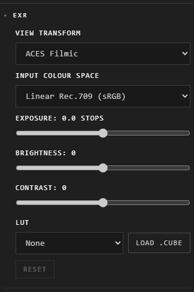

# EXR pictures and grading

An OpenEXR file (.exr), a render's high-dynamic-range light, can be dropped in
like any picture. The Atrium turns it into a picture a screen can show, and
keeps the original so you can grade it again.

## Grade it

Right-click it > **Customize**, then the **EXR** section:

| Control | What it does |
|---|---|
| **View transform** | How light is turned into the screen's colours: **ACES Filmic**, **AgX**, **Standard** or **Data (stretched)** |
| **Input colour space** | What the file's light is in: **Linear Rec.709 (sRGB)**, or **ACEScg** |
| **Exposure** | Brighter or darker, in stops |
| **Brightness**, **Contrast** | Lighter or darker, flatter or punchier |
| **LUT** | A look: **Warm**, **Cool**, **Teal & Orange**, **Bleach Bypass**, **Faded Film**, **Black & White**, **Punchy**, **Day for Night**, or **Load .cube** for your own |
| **Reset** | Back to how it arrived |

While you move a control, a small preview shows at once. Let go, and the whole
picture is graded and kept: one step, **Ctrl+Z** takes it back.

## Good to know

- Multi-layer renders (Blender's view layers and the like) show one layer.
- The original EXR stays beside the graded picture. If it's missing, the app says it can't grade it again.
- A file that can't be opened says so: "it may be damaged, or a kind of EXR that can't be opened here".
- Everything else a picture can do (crop, flip, its Look) works on it too. See [Pictures](pictures.md).

## Related

- [Pictures](pictures.md): what any picture can do.
- [Drop and paste](drop-and-paste.md): bringing files in.
- [The Customization panel](../making-it-look-right/customization-panel.md): its sections.
