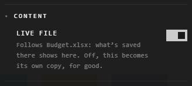

# Live files

In the desktop app, a spreadsheet or a PowerPoint deck you bring in from your
computer stays live: save the file again where it is, and its traces show the
new version within a couple of seconds.

| You bring in | What follows the file |
|---|---|
| A spreadsheet (.xlsx, .csv) | Each sheet trace, and each chart made from it |
| A PowerPoint deck (.pptx) | The deck trace, every slide |

It starts by itself: drag the file onto the canvas, or choose it with the
quick bar's tool.

## See whether a trace follows its file

Right-click the trace > **Customize**. Under **Content**, **Live file** is on,
and names the file.

## Stop following

| You want | Do this |
|---|---|
| It to stay as it is now | Turn off **Live file**, then **Stop following** |
| To edit a sheet's cells here | Double-click a cell: you're asked first, and editing stops it following |

Either way it becomes its own copy, for good: it can't follow the file again.
To follow it again, bring the file in anew.

## Good to know

- An update needs no Save and isn't an undo step. A sheet that gains or loses rows or columns resizes its box, and that waits for Save.
- If the file is moved, renamed or deleted, its traces stay as they last were.
- Following is kept on the computer that brought the file in. On the web, or another computer, the same traces are ordinary copies.
- Pictures, PDFs, videos and sounds don't follow their files: they're copied in once.

## Related

- [Drop and paste](drop-and-paste.md): bringing files in.
- [The desktop vault](../keeping-and-moving/desktop-vault.md): where the copies are kept.
- [The Customization panel](../making-it-look-right/customization-panel.md): where **Live file** is.
