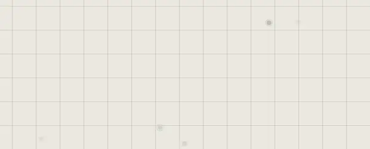

# Paths and arrows

A path is a line through points you place. It can be straight, curved, or bent
at right angles, with an arrow or a diamond at either end.

## Draw a path

| You want | Do this |
|---|---|
| A straight line | Press **4**, then drag |
| A line through several points | Press **4**, click where it starts, then click each next point |
| Finish it | **Esc** |
| End a point on a trace's border | Hold **Shift** as you place or drag the point |

## Change its points

Select the path: its points show.

| You want | Do this |
|---|---|
| Move a point | Drag it |
| Add a point between two | Drag the small mark halfway along the line |
| Carry on from an end | Click its end point, then click on |
| Remove a point | Select it, then press **Delete** |
| Move the whole path | Drag the line itself |

## Its look

In the Customization panel, with the path selected:

| Setting | Choices |
|---|---|
| **Path Style** | **Straight**, **Curved** or **Elbow** (right angles) |
| **Arrow Start**, **Arrow End** | None, an arrow, or a diamond |
| **Line Colour** | Any colour; a palette colour in one click |
| Thickness | How thick the line is |
| **Light** | A glow along the line |

## A path or a connection?

A [connection](../arranging/connections.md) joins two traces and follows them as
they move. A path stays where you drew it, and goes wherever you want: use it for
a line that isn't between two traces, or that bends through several points.

## Good to know

- A path is drawn, not a picture: sharp at any zoom, and in an SVG export.
- **Shift** onto a border holds the point on that trace's edge as you place it; it doesn't follow the trace afterwards.
- An area or a lasso selects a path by its line, not by the box around it.

## Related

- [Connections](../arranging/connections.md): threads that follow their traces.
- [Shapes](shapes.md): boxes, circles and the rest.
- [Drawing](drawing.md): freehand strokes instead of points.
- [The quick bar](quick-bar.md): **Path** and its key.
