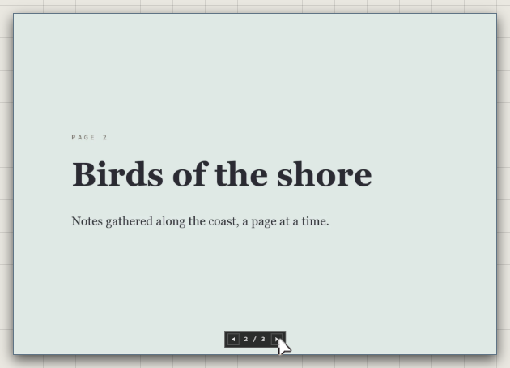

# PDFs and slides

A PDF or a PowerPoint deck (.pptx) becomes one trace that shows a page at a
time. Drag the file onto the canvas, or pick a PDF from the quick bar's
**Other Traces** > **PDF**.

## Turn the pages

The arrows at its foot turn the pages: **◀ 2 / 3 ▶**. Each person turns their
own: it doesn't change the page anyone else sees, and it opens on page 1 again
next time.

**Double-click** it to read it large, in a window of its own.

## One picture per page

Right-click a PDF > **Extract Pages**.

- Each page becomes a picture of its own, in reading order, where the PDF was
  and at the size it was shown.
- They're kept together in a group named after it, or in the group the PDF
  was in.
- The PDF itself goes. It's one step: **Ctrl+Z** puts it back.

The app says how many pages were placed, and how much room they take.

Extract Pages is for PDFs. A deck stays one trace.

## Good to know

- A deck's slides are drawn by the Atrium from the file: text, shapes and pictures, a slide at a time.
- In the desktop app, a deck follows its file: save it again in PowerPoint and its slides update. See [Live files](live-files.md).
- A file that isn't a PDF that can be read says so: "That file could not be read as a PDF".
- In an online atrium, one file can be 25 MB at most. Extracted pages are files of their own and count too. See [Storage and limits](../keeping-and-moving/storage-and-limits.md).

## Related

- [Drop and paste](drop-and-paste.md): bringing files in.
- [Spreadsheets and charts](spreadsheets-and-charts.md): the other documents the Atrium reads.
- [Pictures](pictures.md): what an extracted page can do once it's a picture.
- [Live files](live-files.md): decks that follow their file.
