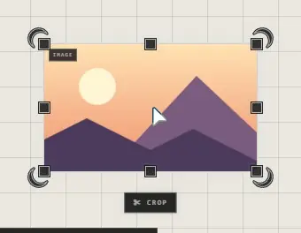
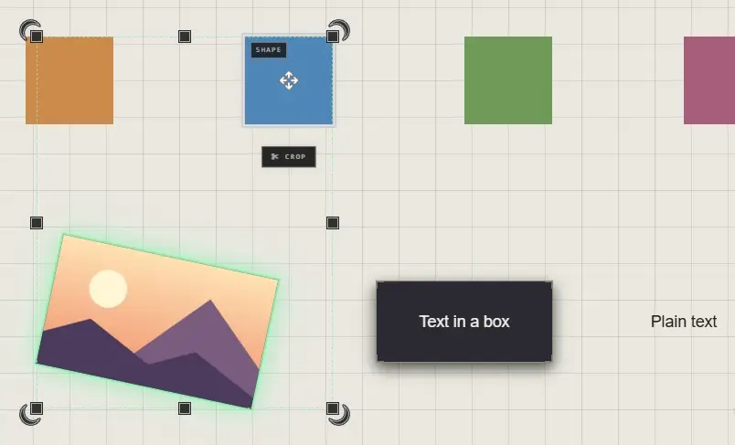

# Pictures

A picture is a trace showing an image file. Bring one in by dropping or pasting
it, or with **Image** (**6**) on the quick bar.

Pictures can be **PNG**, **JPEG**, **GIF**, **WebP**, **SVG**, **AVIF** or **BMP**.
An animated GIF plays.

## Crop, flip, reset

| You want | Do this |
|---|---|
| Show only part of it | Select it, press **Crop** in the Customization panel's footer, drag the edges, then **DONE** |
| An edge lined up with a neighbour | Hold **Shift** while you drag the crop's edge: it lands on the neighbour's edge or middle, or the grid |
| The whole picture again | Right-click it > **Reset Cropping** |
| A mirror image | **Flip Horizontal** or **Flip Vertical**, in the footer, or right-click > **Transformations** |
| Its own proportions again | Right-click it > **Reset Aspect Ratio** |

Cropping hides the rest of the picture; nothing is cut from the file. **Reset
Cropping** brings it all back.

A flip mirrors across the screen's own axes, left to right or top to bottom,
however the picture is turned. Several selected flip as one: the whole selection
turns over about its middle, each trace landing in its mirrored place.

## Good to know

- Pins from Pinterest are shown as Pinterest delivers them: they can't be cropped, flipped or recoloured.
- In an online atrium, one picture can be 25 MB at most. See [Storage and limits](../keeping-and-moving/storage-and-limits.md).
- Paths and frames can't be cropped.

## Related

- [Drop and paste](drop-and-paste.md): every way to bring a picture in, several at once.
- [The quick bar](quick-bar.md): the **Image** tool.
- [Move, resize and rotate](../arranging/move-resize-rotate.md): sizing and turning a picture.
- [The Customization panel](../making-it-look-right/customization-panel.md): a picture's border, shadow and footer buttons.
- [Storage and limits](../keeping-and-moving/storage-and-limits.md): how much space pictures take.
