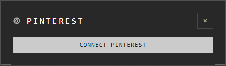

# Importing from Pinterest

Bring a whole Pinterest board into an atrium: each pin becomes a trace.

## Connect Pinterest

The first time, **Your Pinterest Boards** (on the quick bar, or right-click the
canvas) asks you to connect:

Press **Connect Pinterest** and approve it on Pinterest's page. You can also
connect, or disconnect, on your **Profile** > **Pinterest**.

In the desktop app, press **Open browser to connect**: Pinterest gives you a
code in the browser. Enter it in the app and press **Link this app**.

## Import a board

1. **Your Pinterest Boards**, then choose a board.
2. The app finds its pins, and asks: **Import 24 pins from "Kitchen"?**
3. Press **Import 24 pins**.

The pins are laid out around your view, in a new group named after the board.

## What a pin is in an atrium

A pin stays Pinterest's. Its picture and title are read from Pinterest each
time the atrium opens, and nothing of them is kept in the atrium.

| You can | You can't |
|---|---|
| Move it, resize it, group it, connect it | Crop it, flip it, change its colours or corners |
| Open it on Pinterest with its mark | Hide Pinterest's mark: it always shows |
| Share the atrium: others see the pins too | Turn it into a picture, or export it |

In an export, or the atrium's picture on its card, Pinterest's mark stands in
each pin's place.

## Secret boards

A secret board's pins are seen by you alone. Everyone else sees Pinterest's
mark in their place.

## Good to know

- If whoever imported the pins disconnects Pinterest, or a pin is deleted there, the pin shows Pinterest's mark instead of its picture.
- Disconnecting deletes the connection the Atrium kept for you.
- Importing from Pinterest is free.

## Related

- [Embeds and links](embeds-and-links.md): a single link from anywhere, Pinterest included.
- [Groups and the Layers panel](../arranging/groups-and-layers.md): the group a board arrives in.
- [Export](../keeping-and-moving/export.md): what an export holds.
