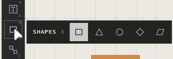

# Shapes

A shape is a trace drawn in a box: a rectangle, triangle, circle, diamond or
parallelogram. Press **3** for **Shapes**, then drag on the canvas.

## Draw a shape

| You want | Do this |
|---|---|
| The shape in use | Press **3**, then drag on the canvas |
| A different kind | Point at **Shapes** on the quick bar and pick one from its flyout |
| The usual size | Press **3**, then click |
| Even: a square, a circle | Hold **Shift** while you drag |
| Several in a row | Keep dragging: **Shapes** stays on until **Esc** |

The button shows the kind in use. The shape you place opens in the
Customization panel.

## Its look

In the Customization panel, with the shape selected:

| Section | Settings |
|---|---|
| **Shape** | **Shape Type**, and **Corners** (rounds the corners of the shape) |
| **Fill** | **Fill Color**, its opacity, or **No Fill** |
| **Outline** | **Show Outline**, its colour and thickness |
| **Light** | The light it gives off |
| **Content** | **Clickable**: a link the shape opens when clicked |

**Quick Presets** at the top give it a house colour scheme in one click, and
clicking a colour in your palette fills it.

## Good to know

- A shape is drawn, not a picture: it stays sharp at any zoom, and in an SVG export.
- A shape can't be cropped in the way a picture is: **CROP** cuts its box, in place.
- Turned shapes snap to 5° steps with **Shift**, like any trace.

## Related

- [The quick bar](quick-bar.md): **Shapes** and its key.
- [Paths and arrows](paths-and-arrows.md): lines, curves and arrows, point by point.
- [The Customization panel](../making-it-look-right/customization-panel.md): every setting a shape has.
- [Colours and the palette](../making-it-look-right/colours-and-palette.md): a colour on a shape in one click.
- [Move, resize and rotate](../arranging/move-resize-rotate.md): sizing and turning.
