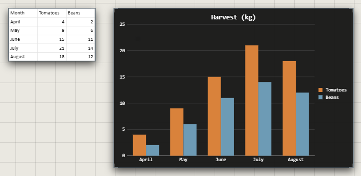

# Spreadsheets and charts

A spreadsheet file becomes what's in it: a sheet trace for each sheet that has
something in it, and a chart trace for each chart. They're placed side by side,
together in a group named after the file. Drag the file onto the canvas, or
pick it from the quick bar's **Other Traces** > **Sheet**.

| File | What comes in |
|---|---|
| Excel (.xlsx, .xlsm) | Its sheets and its charts |
| LibreOffice (.ods) | Its sheets |
| CSV (.csv) | One sheet |

It all arrives as one step: **Ctrl+Z** takes it away again.

## Edit a sheet

**Double-click** a cell and type.

| Key | What it does |
|---|---|
| **Enter** | Keep it, and go down a cell (**Shift+Enter**: up) |
| **Tab** | Keep it, and go across (**Shift+Tab**: back) |
| **Esc** | Leave the cell as it was |

Clicking elsewhere keeps what you typed. Each edit is a step you can undo, and
waits for **Save**, as every change does.

A sheet keeps what its cells show, not their formulas: changing one cell
doesn't recalculate the others. A number you type is set to the right.

## Charts

A chart shows the values saved in the file, drawn in the Atrium's own look.
Its background and text follow the trace's colours: change them in its
Customization panel.

Editing a sheet's cells doesn't redraw a chart: they're separate traces.

## Good to know

- Cells show their values, with their number and date formats. Their fonts, fill colours and borders aren't carried.
- A sheet shows up to 5,000 rows and 200 columns. Anything beyond is noted under it: "12 more rows not shown".
- In the desktop app, a spreadsheet follows its file: save it again and the sheets and charts update. Editing a cell here stops that, after asking. See [Live files](live-files.md).
- A file that can't be read says so: "Can't read this file".

## Related

- [Live files](live-files.md): spreadsheets that follow their file.
- [Groups and the Layers panel](../arranging/groups-and-layers.md): the group a spreadsheet arrives in.
- [PDFs and slides](pdf-and-slides.md): the other documents the Atrium reads.
