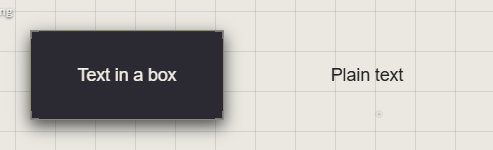

# Text

A text trace holds words. Press **2** for **Text in a box**, click the canvas,
and type.

| Kind | Looks like |
|---|---|
| **Text in a box** | The words, with the box's border and background |
| **Plain text** | Just the words, in black or white to stand out from the background |

## Write and edit

| You want | Do this |
|---|---|
| New text | Press **2**, click the canvas, type |
| Change what it says | Double-click the trace |
| A new line | **Shift+Enter** |
| Finish | **Enter**, or click outside it |
| Stop without keeping what you typed | **Esc** |

## How it fits its box

**Text Sizing**, in the Customization panel:

| Choose | When you resize the box |
|---|---|
| **Fills Box** | The text grows as large as the box allows, and shrinks as you write more |
| **Scales With Box** | The text grows and shrinks with the box |
| **Fixed Size** | The font size stays; the lines reflow to the new width |

## Font, size, colour, alignment

All in the Customization panel, with the trace selected:

- **Font Family** and **Font Size (px)**
- **Text Color**
- **Text Alignment**, and **Vertical Alignment**: **Align top**, **Align center**, **Align bottom**

To give other text the same look, right-click it > **Copy Style**, then
right-click the other > **Paste Style** (**Ctrl+Alt+C**, **Ctrl+Alt+V**).

## Good to know

- You can't add a font of your own: choose from the **Font Family** list.
- In a view-only atrium, or on a locked trace, a double-click opens the text to read and copy instead.
- Text pasted onto the canvas becomes a text trace. See [Drop and paste](drop-and-paste.md).

## Related

- [The quick bar](quick-bar.md): **Text in a box** and its key.
- [The Customization panel](../making-it-look-right/customization-panel.md): every setting a text trace has.
- [Move, resize and rotate](../arranging/move-resize-rotate.md): resizing, and what it does to text.
- [Drop and paste](drop-and-paste.md): pasting text in.
