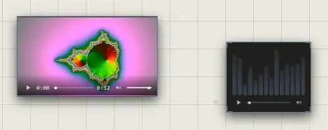

# Video and sound

A video or sound file becomes a trace that plays where you put it. Drag the
file onto the canvas, or pick it from the quick bar's **Other Traces** >
**Video** or **Sound**.

For YouTube, Vimeo or SoundCloud, paste the link instead: it becomes an
embed. See [Embeds and links](embeds-and-links.md).

## Play it

Each has its own bar along its foot:

| Control | What it does |
|---|---|
| ▶ / ❚❚ | Play, pause |
| The timeline | Drag to go anywhere in it |
| The speaker | Mute, unmute |
| The volume | How loud, for you alone |

**Double-click** it to watch or listen to it large, in a window of its own.

## A sound's bars

At rest, the bars show the sound's own shape. While it plays they become an
equalizer of what's heard, low notes to the left. A sound from another site
that doesn't allow it to be read pulses instead.

To colour them, select the sound and click a colour in your palette. Otherwise
they take its border's colour.

## Spatial sound

Turn it on in **User Preferences** > **Sound** > **Spatial sound**. Then a
playing video or sound is heard from where it is:

- in view, as it is;
- off screen, quieter the further away, and from its side;
- a screen and a half away, silent.

An embedded player (YouTube, Vimeo, SoundCloud) gets quieter with distance,
but never moves to a side.

## Good to know

- A file the browser can't play says so: "This file couldn't be played". MP4, WebM, MP3 and WAV play everywhere.
- In an online atrium, one file can be 25 MB at most. See [Storage and limits](../keeping-and-moving/storage-and-limits.md).
- Only the beginning of a video is read until you press play, so an atrium full of videos opens quickly.
- Your volume and mute are yours: no one else hears the change.

## Related

- [Drop and paste](drop-and-paste.md): bringing files in.
- [Embeds and links](embeds-and-links.md): YouTube, Vimeo and other players.
- [User Preferences](../account-and-settings/preferences.md): spatial sound and interface sounds.
