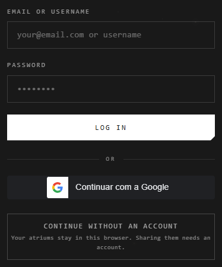

# Accounts

There are three ways in. An account lets you share atriums and open them from
any device.

| Way in | What you get |
|---|---|
| **Email and password** | An account. Online atriums; Google Drive ones once you connect Drive |
| **Continue with Google** | An account in one click; Google Drive atriums at hand |
| **Continue without an account** | Atriums kept in this browser only. Sharing them needs an account |

## Make an account

**With an email:**

1. **Sign up**, then fill in a username, your email, and a password twice.
2. Enter the 6-digit code sent to your email.

The password needs at least 6 characters, with a lowercase letter, an
uppercase letter and a number.

**With Google:** press **Continue with Google**. The first time, choose your
username.

## Your username and your display name

| | What it is | Can change |
|---|---|---|
| **Username** | Unique: how people find and add you. 3 to 20 letters, numbers or underscores | Never |
| **Display name** | The name others see, on your cursor and traces | Once every 15 days, on your Profile |

## Sign in and out

- Sign in with your email **or** your username, and your password.
- **Forgot your password?** sends an email with a 6-digit code: enter it with
  your new password. An older account gets a link instead: follow it.
- To sign out, press your name at the top right > **Log Out**.

After too many wrong passwords for one username, wait 15 minutes, or sign in
with your email.

## Without an account

Your atriums stay in this browser. Sign up or sign in later, and they're still
there, and yours. Clearing the site's data deletes them: export them to keep a
copy. See [Where atriums live](where-atriums-live.md).

## On desktop

The desktop app needs no account: its atriums are on your computer. To open the
atriums shared with you, press **Atriums** > **Your account** > **Sign in with
the browser**, and approve it on the site.

## Good to know

- An address that already signs in with Google can't make a password account: use **Continue with Google**.
- A Google account made with one address is separate from a password account made with another.
- Signing out on desktop leaves your vault's atriums where they are.

## Related

- [Where atriums live](where-atriums-live.md): what each kind of atrium needs.
- [Sharing an atrium](../working-together/sharing.md): what an account lets you share.
- [Google Drive atriums](../working-together/drive-atriums.md): Drive, once you've signed in.
