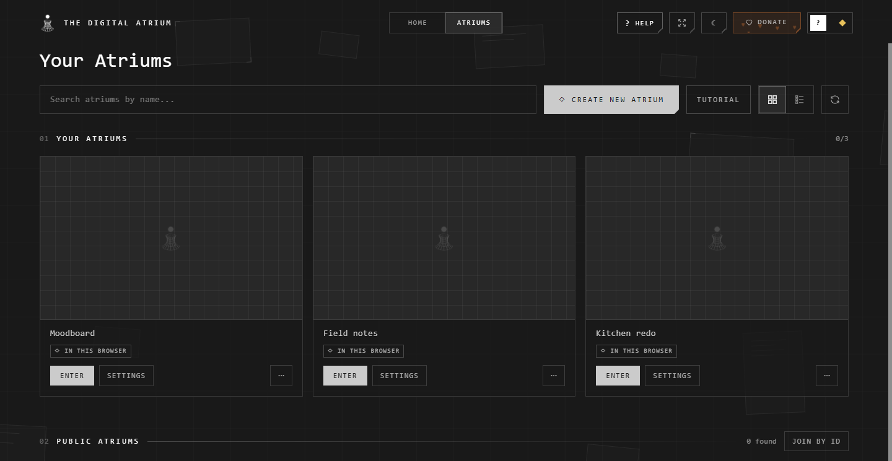

# The Atriums page

**Atriums**, at the top of the screen, lists every atrium you can open.
**Home** beside it takes you back to where you left off.

## What's on it

| Part | What it holds |
|---|---|
| **On this computer** | Desktop: the atriums in your vault |
| **Your atriums** | Those you made. The count shows your online atriums, of the 3 you can have |
| **Shared with you** | Invitations first (**Join** or **Decline**), then the atriums you're in |
| **Public atriums** | Those anyone can open |
| **Import & Export** | Bring in an .atrium file, or save one. Desktop adds **Restore From Vault** |

## Find and open one

- Type in **Search atriums by name** to narrow the lists.
- Switch between cards and a list with the two buttons beside **Tutorial**.
- Press **Enter** on its card.

## A card

| On the card | What it does |
|---|---|
| Its picture | The atrium as it was last saved |
| The tags | Where it lives (**In this browser**, …), who shared it, **View only** |
| **Enter** | Go in |
| **Settings** | Its settings, without going in |
| **⋯** | **Rename**, move it, **Delete** or **Leave**, **Report atrium** |

What **⋯** holds depends on the atrium: see [Moving atriums](../keeping-and-moving/moving-atriums.md)
for the moves. You **Delete** your own; you **Leave** one shared with you.

## Make a new one

Press **Create New Atrium**, name it, and choose where it's kept. See
[Your first atrium](first-atrium.md) and [Where atriums live](where-atriums-live.md).

## Good to know

- **Join by ID**, beside **Public atriums**, opens an atrium from the old cloud by the ID its owner gave you. Atriums now share by invitation: see [Sharing an atrium](../working-together/sharing.md).
- An atrium that couldn't come back from the old cloud waits under **Waiting to come back**. See [Moving atriums](../keeping-and-moving/moving-atriums.md).
- The refresh button reads the lists again.

## Related

- [Your first atrium](first-atrium.md): from an empty atrium to a shared one.
- [Where atriums live](where-atriums-live.md): what the tags mean.
- [Public atriums](../working-together/public-atriums.md): looking at others' work.
- [Import](../keeping-and-moving/import.md) and [Export](../keeping-and-moving/export.md): the .atrium file.
