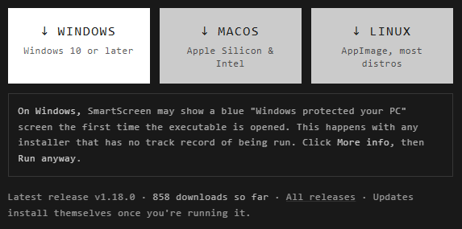
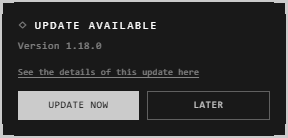

# Installing the desktop app

Download it from digitalatrium.org: **Get the desktop app**, or the buttons
under **Two ways in**. Each button gets the newest version.

| System | Download | Needs |
|---|---|---|
| **Windows** | An installer (.exe) | Windows 10 or later |
| **macOS** | A disk image (.dmg) | Apple Silicon or Intel |
| **Linux** | An AppImage | Most distributions |

**All releases**, under the buttons, also has .deb and .rpm packages for Linux.

## The first launch

The app isn't signed with a paid developer certificate, so each system warns
you the first time. Point at a download button on the site to see its note.

| System | You see | Do this |
|---|---|---|
| **Windows** | A blue "Windows protected your PC" screen | **More info**, then **Run anyway** |
| **macOS** | "Cannot be opened because the developer cannot be verified" | Right-click the app > **Open**, then confirm. macOS remembers |
| **Linux** | The AppImage won't start | Tick **Allow executing file as program** in its properties, or run `chmod +x` on it. Some systems also need FUSE |

On Windows, the app installs for you alone: no administrator is needed, and
updates install without asking for one.

## Updates

The app looks for a new version when it starts, every hour, and whenever the
computer reconnects. When there is one, a card says so:

- **Update Now** downloads it, installs it and restarts the app.
- **Later** puts it off; the app asks again.
- **See the details of this update here** shows what's new.

## Good to know

- Your atriums aren't in the app's folder but in the vault, so updating or uninstalling leaves them where they are. See [The desktop vault](../keeping-and-moving/desktop-vault.md).
- The desktop app needs no account. To open the atriums shared with you, sign in. See [Accounts](accounts.md).

## Related

- [Web or desktop](web-or-desktop.md): what the desktop app adds.
- [The desktop vault](../keeping-and-moving/desktop-vault.md): where its atriums are kept.
- [Overlay mode](../keeping-and-moving/overlay-mode.md): something only the desktop app does.
