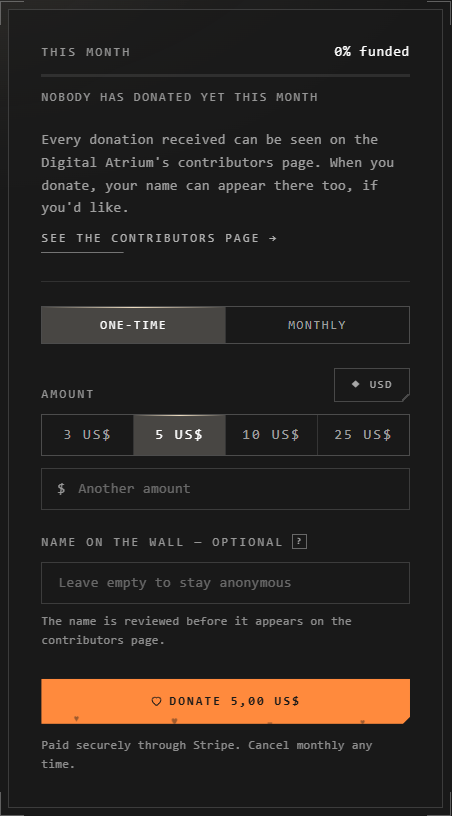

# Supporting the Atrium

The Digital Atrium is free to use. Donations go toward its continued
development.

## Donate

Press **Donate** at the top of Home.

1. Choose **One-time** or **Monthly**.
2. Pick an amount, or type **Another amount**. The currency can be changed.
3. Add a **Name on the wall** if you'd like it there, or leave it empty.
4. Press **Donate**, and pay through Stripe.

A receipt is emailed to you.

## The contributors wall

**Home** > **Contributors** shows everyone who donated, with ranks by amount
and who gives monthly. Search it by name.

A name is reviewed before it appears, usually within 48 hours. Names
considered offensive are turned down. Leave the field empty, and your donation
is counted without a name.

## Good to know

- A monthly donation can be cancelled any time.
- Now and then Home shows a small card asking for support. Once it knows of a
  donation from your account's address, it stays quiet for six months.
- Paying is handled by Stripe: the Atrium never sees your card.

## Related

- [Report a problem or suggest a feature](report-or-suggest.md): other ways to help it get better.
