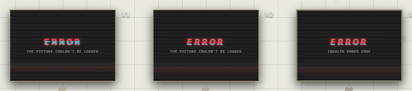

# When something breaks

A trace that can't show what it holds keeps its place and says why:

## On the canvas

| You see | Why | Do this |
|---|---|---|
| **The picture couldn't be loaded** | Its file is gone, or its link broke | Delete it and bring the picture in again |
| **Missing file** | Desktop: its file isn't in the vault | **Atriums** > **Restore From Vault**. See [The desktop vault](../keeping-and-moving/desktop-vault.md) |
| **Invalid embed code**, or an empty frame | The link isn't one that can be shown, or the site refuses to be framed | See [Embeds and links](../bringing-things-in/embeds-and-links.md) |
| **This file couldn't be played** | The browser can't play its format | Bring it in as MP4, WebM, MP3 or WAV |
| **Can't be shown here** | A kind of trace this version can't show | Update the app, or open the atrium on the web |

## Saving

| You see | Do this |
|---|---|
| The save button says **Not saved — retry** | Press it. Your changes stay until a save goes through |
| "Not enough room in your cloud space", or in your Google Drive | Make room. See [Storage and limits](../keeping-and-moving/storage-and-limits.md) |
| **Reconnect to Google Drive to save** | Press it, and sign in to Google again |
| Google is **refusing downloads from this network** | Wait a few minutes, then try again |

Closing the page with changes not saved, the browser asks first: leave anyway,
and what wasn't saved is lost.

## Signing in

| You see | Do this |
|---|---|
| **Wrong username or password** | Check them, or **Forgot your password?** |
| **Too many tries for this username** | Wait 15 minutes, or sign in with your email |
| "This address already has an account that signs in with Google" | Use **Continue with Google** |

See [Accounts](../getting-started/accounts.md).

## The desktop app

| You see | Do this |
|---|---|
| **Vault already open** | Close the app in the other Windows session, then **Try again** |
| **Database damaged** | Rebuild the atriums from the vault: **Restore From Vault** |
| A warning the first time it opens | See [Installing the desktop app](../getting-started/install-desktop.md) |

## Still stuck

Tell us: **Help** > **Report a problem or suggest a feature**. Every report is
read. See [Report a problem or suggest a feature](report-or-suggest.md).

## Related

- [Report a problem or suggest a feature](report-or-suggest.md): telling us what went wrong.
- [Undo and saving](../arranging/undo-and-saving.md): what Save does.
- [Storage and limits](../keeping-and-moving/storage-and-limits.md): when there's no room.
