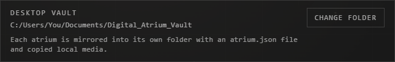
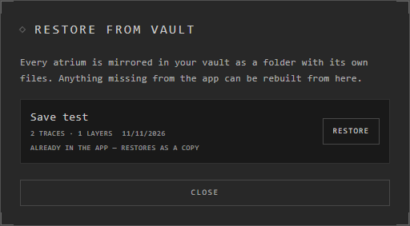

# The desktop vault

The desktop app keeps your atriums in one folder on your computer: the vault.
Each atrium has its own folder inside, with an `atrium.json` file and copies
of its pictures and other files.

| System | Where it is at first |
|---|---|
| Windows, Linux | `Documents/Digital_Atrium_Vault` |
| macOS | The app's own folder in `Library/Application Support`, then `Digital_Atrium_Vault` |

**Atriums** shows where yours is, under **Desktop Vault**.

## Move it

1. **Atriums** > **Desktop Vault** > **Change Folder**.
2. Choose a folder.

Your atriums are copied there, and the app uses that folder from then on. The
old folder stays as it was: delete it yourself once you've checked the new one.

If the folder you choose already holds a vault, the app opens that vault instead.

## Keep a backup

The vault is ordinary files: copy the whole folder somewhere safe, or let your
usual backup take it. To keep one atrium on its own, export it as an .atrium
file. See [Export](export.md).

## Rebuild an atrium from the vault

If an atrium is missing from the app, or the app says its database is damaged,
it can be rebuilt from its folder.

1. **Atriums** > **Restore From Vault**.
2. Each atrium found shows how many traces and layers it holds, and when.
3. Press **Restore**.

One still in the app comes back as a copy beside it. The app says what came
back, and names any file it couldn't find: those traces keep their place,
empty.

## Store embeds as files

**Menu** > **Store Embeds Locally** downloads every embed that is a link to a
picture and keeps the picture in the vault, so it shows offline. Embeds of
other kinds (videos, web pages, pins) stay links: the app says how many it
left.

## Good to know

- One vault can be open in one Windows session at a time. If another session has it open, the app says so: close it there first.
- The vault stays on your computer: nothing in it is sent anywhere unless you put an atrium online. Signing in only adds the atriums shared with you.
- A desktop atrium has no size limit but your disk.

## Related

- [Where atriums live](../getting-started/where-atriums-live.md): the vault beside the other places.
- [Moving atriums](moving-atriums.md): putting a desktop atrium online.
- [Export](export.md) and [Import](import.md): an atrium as a single file.
- [Live files](../bringing-things-in/live-files.md): a dropped file that follows its original.
