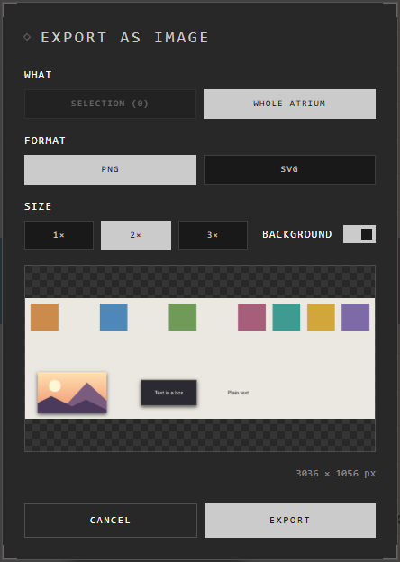

# Export

Export makes a file from your atrium: a picture of it, a copy of it, or a web
page of it.

| You want | Choose | You get |
|---|---|---|
| A picture to post or print | **Menu** > **Export as image** (**Ctrl+Shift+E**) | A PNG or SVG |
| A copy to keep, or to send | **Menu** > **Export Atrium to…** | An .atrium file |
| Something anyone can look around | **Menu** > **Export as web page** | One .html file |

## A picture

1. Select what you want in it, or nothing for all of it.
2. Press **Ctrl+Shift+E**, or right-click a selected trace > **Export…**.
3. Choose:
   - **What**: **Selection (5)** or **Whole atrium**.
   - **Format**: **PNG** (pixels) or **SVG** (sharp at any size).
   - **Size**: **1×**, **2×** or **3×**, with the size in pixels shown.
   - **Background**: the room's colour behind it, or none (see-through).
4. Press **Export**.

A selected frame comes out with everything it holds.

## A copy: the .atrium file

**Menu** > **Export Atrium to…** saves the whole atrium as one .atrium file:
traces, groups, connections and locations, with its pictures and files packed
inside. It opens again in the app or on the web, as a new atrium or added to one.
See [Import](import.md).

## A web page

**Menu** > **Export as web page** makes one .html file of the whole atrium, on its
theme's background. Whoever opens it can drag, zoom and fly to its locations, but
not change anything. It works offline, and can be put up on any website as it is.
Text, shapes and lines stay sharp however close one looks.

## Good to know

- A PNG has a largest size: past it, **2×** and **3×** are off and the app makes the biggest it can. An SVG has no such limit.
- Pins from Pinterest can't be put in a picture: exports show Pinterest's mark in their place.
- An embedded web page can't be drawn into a picture.
- An .atrium file is a copy: changes to it and to the atrium don't reach each other.

## Related

- [Import](import.md): open an .atrium file again.
- [Storage and limits](storage-and-limits.md): keep a copy before you delete things.
- [Sharing an atrium](../working-together/sharing.md): browser and desktop atriums are shared as .atrium files.
- [Frames](../arranging/frames.md): exporting a frame takes what it holds.
- [Selecting](../arranging/selecting.md): choose what goes in the picture.
