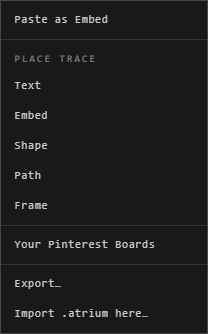

# Import

An .atrium file, made with **Export Atrium to…**, opens again anywhere: as an
atrium of its own, or added to the one you're in.

| You want | Do this |
|---|---|
| A new atrium from the file | On Home, press **Import (.atrium)** |
| What it holds, added to this atrium | Right-click the canvas > **Import .atrium here…** |
| The same, by dragging | Drop the .atrium file on the canvas, where you want it |

## As a new atrium

1. On Home, press **Import (.atrium)** and choose the file.
2. Check what's in it: its traces, groups, locations and files, and when it was exported.
3. Give it a name. On the web, choose **Where it's kept**: **Online** or **In this browser**.
4. Press **Import**.

## Into the atrium you're in

1. Right-click the canvas where you want it.
2. Choose **Import .atrium here…**, and the file.

Or drop the .atrium file there instead.

What the file holds comes in centred there. It arrives as one step: **Ctrl+Z**
takes all of it back.

The app says what came in: **12 traces added**.

## Good to know

- A trace that pointed to a file on the computer it came from (a desktop atrium's
  live file) comes in without that file, keeping its place: the app says how many.
- It has to fit: an online atrium's import needs room in your cloud space, a Drive
  atrium's in your Drive. The app says how much it needs and how much is free.
- **Force import incompatible traces** brings in traces this atrium can't hold as
  an error in their place, so you still see where everything was.
- An import is a copy: the file and the atrium don't change each other afterwards.

## Related

- [Export](export.md): make an .atrium file.
- [Sharing an atrium](../working-together/sharing.md): send a browser or desktop atrium as a file.
- [Storage and limits](storage-and-limits.md): room for what you import.
- [Drop and paste](../bringing-things-in/drop-and-paste.md): dropping files of other kinds.
- [Undo and saving](../arranging/undo-and-saving.md): one **Ctrl+Z** takes an import back.
