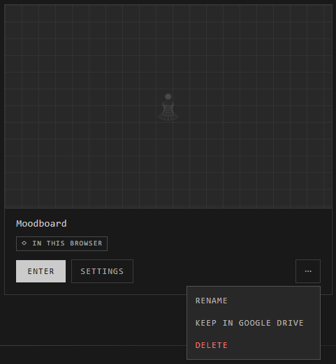

# Moving atriums

Where an atrium is kept decides who can reach it and how much it holds. To
change it, open **Atriums** and use the atrium's card menu (**⋯**).

| It's kept | To | Choose | On |
|---|---|---|---|
| In this browser | Google Drive | **Keep in Google Drive** | Web |
| Online | Your Google Drive | **Move to my Drive** | Web |
| On this computer | Online, or your Google Drive | **Put online…** | Desktop |
| Online or in Drive | This computer, as a copy | **Keep an offline copy** | Desktop |

## On the web

**Keep in Google Drive** puts a browser atrium into your Drive, encrypted. It
can then be shared, and opened from other devices.

**Move to my Drive** moves your online atrium into your own Drive, for more
room. Once Drive has all of it, its online copy is deleted. Its people come
too and join by themselves; its admins come in as editors, since Drive shares
by Google address.

To put a browser atrium online instead, export it as an .atrium file and
import it as **Online**. See [Export](export.md) and [Import](import.md).

## On desktop

Sign the app in first: **Atriums** > **Your account** > **Sign in with the
browser**.

**Put online…** sends a copy of a desktop atrium online. Choose **The Atrium's
cloud** or **Your Google Drive**. The one on this computer stays as it is.

- If you already have an atrium of that name there, choose **Replace its
  contents** (its people stay) or **Add as a new atrium**.
- If it doesn't fit, the app says how much it needs and how much is free.

**Keep an offline copy** makes a copy of an online or Drive atrium in the
desktop vault: an atrium of its own, apart from the original from then on.

## Atriums from the old cloud

Atriums made before the Atrium's new cloud move by themselves the next time
their owner opens **Atriums**, with everyone in them:

> **"Moodboard" moved to the Atrium's new cloud, with everyone in it.**

One that didn't fit in your space waits under **Waiting to come back**. Make
room and press **Try again**, or choose **Move to my Drive**, or **Download**
it as an .atrium file.

## Good to know

- On desktop, **Your Google Drive** needs Drive connected on digitalatrium.org first; then sign the app in again.
- Online, you can own up to 3 atriums, 50 MB in all. See [Storage and limits](storage-and-limits.md).
- A copy and its original don't change each other afterwards.

## Related

- [Where atriums live](../getting-started/where-atriums-live.md): the places, side by side.
- [Google Drive atriums](../working-together/drive-atriums.md): what changes once it's in Drive.
- [Storage and limits](storage-and-limits.md): how much each place holds.
- [Export](export.md) and [Import](import.md): moving by .atrium file.
- [The desktop vault](desktop-vault.md): where desktop atriums live.
