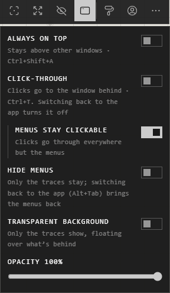

# Overlay mode

In the desktop app, an atrium can float over your other windows: a reference
board beside whatever you're working in. Open **Overlay** on the view bar.

## The settings

- **Always on top** (**Ctrl+Shift+A**): the window stays above every other window.
- **Click-through** (**Ctrl+T**): clicks go to the window behind it.
- **Menus stay clickable**: with click-through, clicks go through everywhere but the menus.
- **Hide menus**: only the traces stay on screen.
- **Transparent background**: only the traces show, floating over what's behind.
- **Opacity**: how see-through the canvas is, 0 to 100%.

**Menus stay clickable**, **Transparent background** and **Opacity** are on
Windows only.

## Use it as a reference board

1. Turn on **Always on top**, and place the window where you want it.
2. Turn on **Transparent background**, or lower **Opacity**, to see your work through it.
3. Turn on **Click-through** to work in the window behind without moving it.

## Get back out

| You want | Do this |
|---|---|
| Click-through and hidden menus off | Switch back to the app: **Alt+Tab**, or its taskbar button |
| Everything back as it was | **Exit overlay mode**, in the panel |
| Out from anywhere | **Ctrl+Alt+Shift+X**, or on Windows the button on the app's taskbar preview |

**Exit overlay mode** makes the window clickable, solid and with its menus
again. **Always on top** stays as you set it.

## Good to know

- Opacity changes only the canvas: traces and menus stay solid.
- Click-through and hidden menus are never remembered: the app always opens with them off.
- **Ctrl+Alt+Shift+X** works only while overlay mode is on, so it never takes that key from other apps otherwise.

## Related

- [Keyboard shortcuts](../moving-around/keyboard-shortcuts.md): every key, overlay mode's included.
- [Moving around](../moving-around/moving-around.md): fitting the view to what you want to keep in sight.
- [The desktop vault](desktop-vault.md): where desktop atriums are kept.
