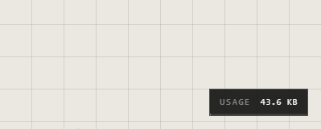

# Storage and limits

How much an atrium can hold depends on where it lives. The **Usage** meter at
the bottom right of an atrium shows its size.

| The atrium lives | Its room | When it's full |
|---|---|---|
| Online (kept by the Atrium) | Your cloud space: **50 MB** for all your online atriums together, **25 MB** for one file | "Not enough room in your cloud space" |
| In Google Drive | Your own Google Drive's free space | "Not enough space in your Google Drive" |
| In this browser | What the browser lets the site keep | The browser refuses it |
| On this computer (desktop) | Your disk | Your disk is full |

You can own up to **3** online atriums.

## Read the Usage meter

- The number is the atrium's size.
- In an online or Drive atrium, beside it: how much room is free, **… free in
  your cloud space** or **… free in Drive**.
- Point at it for the whole space: **Your cloud space: … of … used, … free**, or
  **Google Drive: … of … used, … free**.
- The thin line along its foot shows how near the limit you are. It turns yellow
  at 80% and red when full.

A browser or desktop atrium shows only its size: there is no Atrium limit for it.

## Make room

| You want | Do this |
|---|---|
| Free space in an online atrium | Delete traces you don't need, pictures and files first: they take the most |
| More room than the cloud space gives | Move the atrium into your Google Drive. See [Moving atriums](moving-atriums.md) |
| Room in Google Drive | Free space in your Drive, or get more from Google |
| Keep a copy before deleting | Export it as an .atrium file. See [Export](export.md) |

Deleting a trace frees its space once the atrium is saved. What another online atrium of yours
holds counts too: the 50 MB is shared.

## Good to know

- The 50 MB and the 3 online atriums are per person, for all your online atriums together.
- One file in an online atrium can be 25 MB at most, whatever space is left.
- Links and embeds (videos, web pages, pins) take almost no space: only their address is kept.
- A Drive atrium is limited only by your Drive's space.
- Browser atriums live in this browser only: clearing the site's data deletes them. Export them to keep a copy.

## Related

- [Where atriums live](../getting-started/where-atriums-live.md): the kinds of atrium, and which one to pick.
- [Moving atriums](moving-atriums.md): move an online atrium into your Google Drive for more room.
- [Drop and paste](../bringing-things-in/drop-and-paste.md): what adding a file does, and how big it can be.
- [Export](export.md): keep a copy before you delete things.
- [The desktop vault](desktop-vault.md): where a desktop atrium's files are kept on disk.
