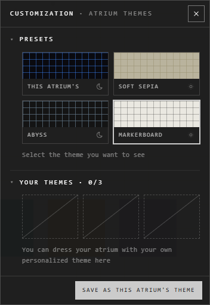

# Atrium themes

Open **Atrium Themes** on the view bar. The atrium changes behind the panel as
you pick.

## Pick what you see

Under **Presets**: **This atrium's** theme, **Soft Sepia**, **Abyss** or
**Markerboard**. Your pick is for you alone: everyone else still sees what they
chose.

A theme is light or dark, and the interface follows it.

## Make your own

1. Pick the theme to start from.
2. Under **Your themes**, press an empty slot: a new theme, from the one showing.
3. Name it, mark it light or dark, and change it below.

| Part | What you set |
|---|---|
| **The grid** | **Lines**, **Dots** or **None**; its colour, opacity and size |
| **The room** | Its colour, and a **Background picture**: opacity, size, one picture over the whole view, parallax |
| **Drifting particles** | On or off; how many, their colour and opacity |
| **Ground** | Things scattered on the floor: pebbles, grass, leaves, flowers, stardust and more, or pictures of your own by link |

Your themes are kept with your account: 3 on the web. The desktop app also
keeps 9 on the device; **Put online** moves one to your account.

## The atrium's theme

The owner and the admins can make what's showing everyone's: **Save as this
atrium's theme**.

## Good to know

- The grid's size is also what **Shift** snaps a dragged trace to.
- Light or dark for the interface alone: the sun and moon button at the top right. See [Language and theme](../account-and-settings/language-and-theme.md).

## Related

- [The Customization panel](customization-panel.md): the look of a single trace.
- [User Preferences](../account-and-settings/preferences.md): how the atrium moves and sounds.
