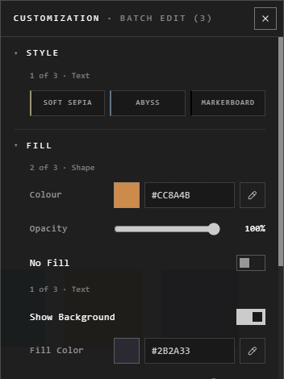

# Batch Edit

Select several traces, then right-click one > **Batch Edit (3)**. It's the
Customization panel, for all of them at once.

## How it reads

- Every setting that **any** selected trace has shows, in its usual section.
- Where it isn't for all of them, a note says which: **2 of 3 · Shape**,
  **1 of 3 · Text**. Changing it changes only those.
- A switch they disagree on shows a dash. A value shown is the first trace's.

Each change is one step: **Ctrl+Z** takes it back on all of them.

## Good to know

- The footer's buttons work on all of them too: duplicate, order, lock, delete.
- To make several look like one, **Copy Style** on it and **Paste Style** on them may be quicker. See [Colours and your palette](colours-and-palette.md).

## Related

- [The Customization panel](customization-panel.md): what each section holds.
- [Selecting](../arranging/selecting.md): picking the traces to change.
- [Colours and your palette](colours-and-palette.md): copying a style.
