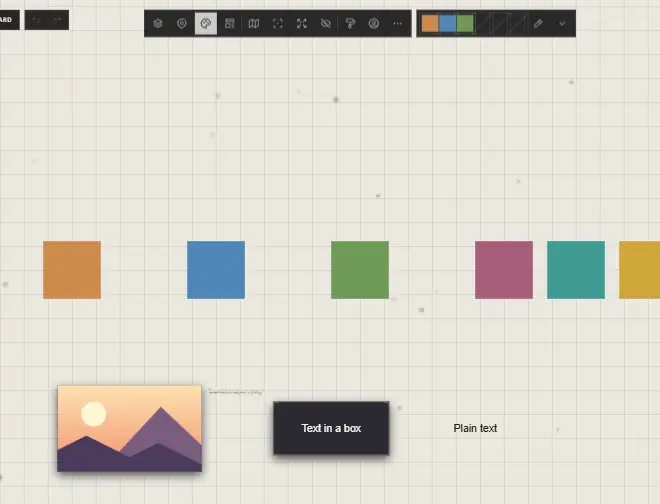

# Colours and the palette

Your palette keeps colours you use often, the same in every atrium. Open it with
**Palette** on the view bar.

## Use a colour

| You want | Do this |
|---|---|
| It on what's selected | Click it in the palette |
| Its code, to paste elsewhere | Click it with nothing selected: it's copied, as `#cc8a4b` |
| A different colour in its place | Right-click it, and choose one |
| It gone | Point at it, then press the **×** on its corner |
| One trace's whole look on another | Right-click it > **Copy Style**, then right-click the other > **Paste Style** (**Ctrl+Alt+C**, **Ctrl+Alt+V**) |

Clicking a colour changes a shape's fill, a path's line, a text's colour and a
frame's border, for everything selected, in one step.

## Add a colour

| You want | Do this |
|---|---|
| The colour under the pointer | Point at it on the canvas and press **I** |
| The same, with a click | Press the dropper in the palette, then click what to take the colour of |
| One you choose | Click an empty place in the palette |
| More room | The arrow opens two more rows: 18 colours in all |

The dropper takes the colour as it's drawn there: the letters of a text or the
box behind them, a pixel of a picture, the room's own ground. In Chrome and
Edge, it takes a colour from anywhere on your screen.

## Good to know

- The palette is kept in this browser or on this computer. It doesn't follow your account to another device.
- An embedded web page's colours can't be read, nor a picture from a site that doesn't allow it: the app says "That one's colours can't be read here".
- Shadows and glows aren't picked: the dropper reads the colour under them.
- When the palette is full, remove a colour first.

## Related

- [The Customization panel](customization-panel.md): every colour setting a trace has.
- [Text](../bringing-things-in/text.md): a text's colour.
- [Connections](../arranging/connections.md): a thread's colour.
- [Keyboard shortcuts](../moving-around/keyboard-shortcuts.md): **I** and the rest.
