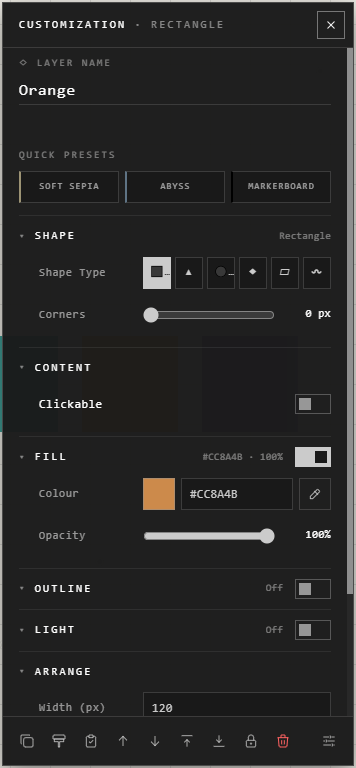

# The Customization panel

The Customization panel holds every setting of the trace you're working on. Open
it with right-click > **Customize**. A shape, path or frame you've just placed
opens it by itself.

At the top, **Layer name**: what the trace is called in the Layers panel. Below
it, **Quick presets** give it one of the house colour schemes in one click:
**Soft Sepia**, **Abyss** or **Markerboard**. A boxed trace takes the scheme's
font too, and the next trace you make looks the same.

Below them, the sections show only what that kind of trace has.

## The sections

| Section | Holds | Shown for |
|---|---|---|
| **Shape** | The shape's type and its corners | Shapes |
| **Content** | What it shows or opens: its link, its file; **Clickable** for a shape | Embeds, pictures, documents, shapes |
| **Text** | Font, size, colour, alignment, Text Sizing | Text, and shapes with words |
| **Colour** | The picture's grading | Pictures |
| **Stroke** | A drawing's stroke colour | Drawings |
| **Fill**, **Background** | What's inside it | Shapes; boxed traces |
| **Outline**, **Border** | Its edge | Shapes; boxed traces |
| Shadow, **Light** | Its shadow; the light it gives off (**Glow** along a path) | Most traces |
| **Captions** | The username and description shown with it | Boxed traces |
| **Arrange** | Size, order, locked | Every trace |

A section with a switch in its heading is off or on as a whole: off, its
settings are hidden and not drawn.

## Footer buttons

The row of buttons along the panel's foot are shortcuts: duplicate, copy and
paste style, move up and down, lock, delete, and others.

1. Press **Choose these buttons** at the end of the row.
2. Pick up to 9, and drag them into the order you want.

Buttons that don't apply to the trace in hand are hidden. Your choice is kept
on this device.

## Several traces at once

Select several traces, then right-click > **Batch Edit (5)**. It shows every
setting any of them has, says which traces a setting is for when it isn't all of
them, and changes only those.

## Good to know

- Everything in the footer is also in the sections or the right-click menu: the footer only saves a trip.
- Changes wait for **Save** like any other. See [Undo and saving](../arranging/undo-and-saving.md).
- **Copy Style** and **Paste Style** (**Ctrl+Alt+C**, **Ctrl+Alt+V**) carry every setting two traces share.

## Related

- [Text](../bringing-things-in/text.md): the Text section in detail.
- [Pictures](../bringing-things-in/pictures.md): crop and flip, from the footer.
- [Frames](../arranging/frames.md): a frame's look and its Arrange settings.
- [Groups and the Layers panel](../arranging/groups-and-layers.md): order and locking, for groups too.
- [Move, resize and rotate](../arranging/move-resize-rotate.md): sizing by hand instead of by number.
- [Templates](../bringing-things-in/templates.md): values that change many traces' settings at once.
