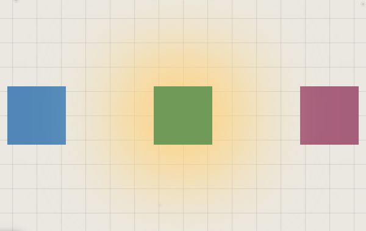
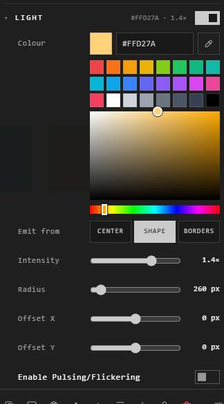

# Light, glow and shadow

A trace can give off light onto the canvas around it, like a lamp:

## Give a trace light

Right-click it > **Customize**, and turn on **Light** (on a path, **Glow**).

| Setting | What it does |
|---|---|
| **Colour** | The light's colour |
| **Emit from** | **Center**, the whole **Shape**, or its **Borders** |
| **Intensity** | How bright |
| **Radius** | How far it reaches |
| **Offset X**, **Offset Y** | Move the light from the trace's middle |
| **Enable Pulsing/Flickering** | It breathes; **Pulse** sets the seconds per cycle, lower is faster |

The Layers panel marks a trace that emits light.

## A soft shadow

Turn on **Soft Shadow** in the Customization panel for a soft drop shadow
under the trace. It needs **Show Background** on to be seen.

## Good to know

- Light falls on the canvas, under the traces: it doesn't change their colours.
- Several traces can be lit at once with Batch Edit. See [Batch Edit](batch-edit.md).

## Related

- [The Customization panel](customization-panel.md): every section.
- [Paths and arrows](../bringing-things-in/paths-and-arrows.md): glowing lines.
- [Atrium themes](atrium-themes.md): the room the light falls in.
