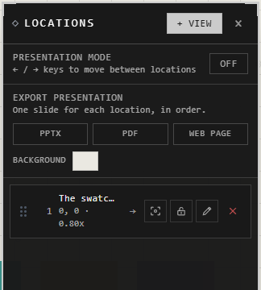

# Locations and presenting

A location is a view of the atrium you've saved: where you were looking, and how
close. Fly back to it in a moment, present your locations one after another, or
make slides of them.

Open them with **Locations** on the view bar.

## Save and visit

| You want | Do this |
|---|---|
| Keep what you see now | Frame the view, press **+ View**, and name it |
| Go there | Double-click it in the list, or **Fly here** |
| Update it to the view now | **Set this location to the current camera view** |
| Keep it from being overwritten | Lock it |
| Rename it, or delete it | The pencil, or the **×**, on its row |

## Present

1. Press **Present** (**Start presentation mode**).
2. Move between your locations with **→** and **←**, in the list's order.
3. Click to stop.

## Export as slides

**Export presentation** makes one slide for each location, in order:

| Choose | You get |
|---|---|
| **PPTX** | A PowerPoint deck |
| **PDF** | A PDF, a page a slide |
| **Web page** | One .html file that opens anywhere, offline |

**Background**: the atrium's own, or one you choose.

## Good to know

- Locations are saved with the atrium: everyone in it sees the same ones.
- A location is a view, not a copy: what's there when you fly to it is what's there now.
- A frame makes a good location: frame it, and save the view.

## Related

- [Moving around](moving-around.md): moving and zooming the view by hand.
- [Frames](../arranging/frames.md): areas worth a location of their own.
- [Export](../keeping-and-moving/export.md): pictures, files and web pages of the atrium itself.
- [Keyboard shortcuts](keyboard-shortcuts.md): the arrow keys while presenting.
