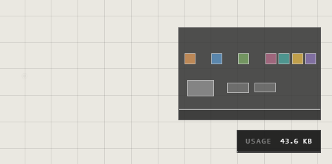
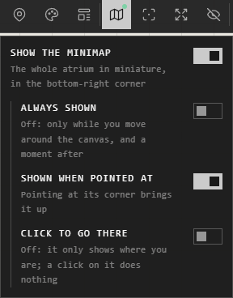

# Minimap and view

## The minimap

The whole atrium in miniature, bottom right, with your view as a frame on it.
It shows while you move around, and goes a moment after.

Its settings are under **Minimap** on the view bar:

- **Show the minimap**: on or off.
- **Always shown**: off, it shows only while you move.
- **Shown when pointed at**: pointing at its corner brings it up.
- **Click to go there**: a click or a drag on it takes your view there. Off, it only shows where you are.

## Traces off screen

In **User Preferences** > **What you see**:

| Setting | What it does |
|---|---|
| **Point to off-screen traces** | Arrows at the edge of the screen, toward traces out of view, with how far away each is |
| **Fade traces near the edge** | Traces fade softly as they leave the view |
| **Label each trace's type** | Every trace shows its type, selected or not |

## A clean view

| You want | Do this |
|---|---|
| Only the canvas and its traces | **Hide UI** on the view bar |
| The interface back | **Show UI**, at the top right, dimmed until you reach for it |
| The whole screen | **Fullscreen** on the view bar, or **F11** |

## Good to know

- On a phone there's no minimap: the screen is too small for it.
- To jump to a place you use often, save it as a location. See [Locations and presenting](locations-and-presenting.md).

## Related

- [Moving around](moving-around.md): panning and zooming.
- [Locations and presenting](locations-and-presenting.md): saved views.
- [User Preferences](../account-and-settings/preferences.md): every setting of what you see.
