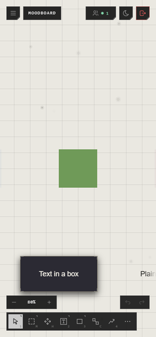

# Phones and tablets

On a screen narrower than 640 pixels, the atrium is laid out for a thumb.

## What's different

- **The quick bar runs along the foot**, as many tools across as fit, **⋯**
  for the rest. A tool's options open above it on a press, since there's no
  pointing without touching.
- **Zoom and undo** sit just above the quick bar.
- **No minimap**: the screen is too small for it.
- The view bar's buttons (Layers, Locations, Palette, Templates and the rest) are
  in the menu at the top left.

## Touch

| You want | Do this |
|---|---|
| Move around | Drag empty canvas with one finger |
| Zoom | Pinch with two fingers |
| Move a trace | Press it and drag |

## Good to know

- A tablet wide enough gets the full layout, used by touch.
- A pen draws with pressure, where the device gives it. See [Drawing](../bringing-things-in/drawing.md).
- On touch, Pinterest's mark on a pin always shows, since there's no hovering.

## Related

- [Moving around](moving-around.md): panning and zooming in general.
- [The quick bar](../bringing-things-in/quick-bar.md): the tools.
- [Minimap and view](minimap-and-view.md): what a phone leaves out.
