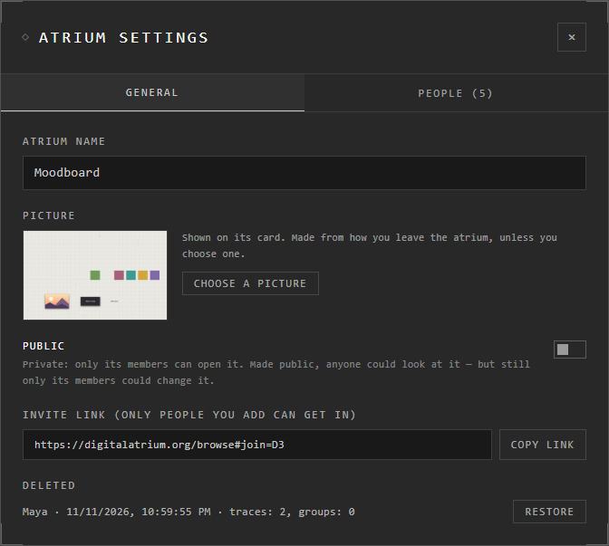

# Google Drive atriums

A Google Drive atrium is kept in your own Google Drive, encrypted: only its
members hold the keys to open it. It can be as big as your Drive has room for.

## Make one

1. **Atriums** > **Create New**, and choose **In Google Drive**.
2. The first time, Google asks you to sign in and let the Atrium use your
   Drive. Leave **both** boxes ticked: one is for the atrium's files, the other
   for its own folder, where your keys are kept.

An atrium you already have can move into Drive too. See [Moving atriums](../keeping-and-moving/moving-atriums.md).

## Members

Add people, give them roles, and let in those who ask, as in any shared
atrium. See [People and roles](people-and-roles.md) and [Sharing an atrium](sharing.md).

One difference: to make someone an admin, you give the Google address they use
with the Atrium. Drive shares the member list with that address.

## Bring back deleted traces

The owner and the admins can bring back what anyone deleted.

1. **Menu** > **Atrium Settings** > **General**.
2. Under **Deleted**, press **Look for deleted traces**.
3. Each deletion shows who made it, when, and how many traces and groups.
   Press **Restore**, or **Restore all**.

Deletions can be brought back for at least 30 days.

## Opening and saving

- Opening it, the app first brings in what's new from Drive: **Bringing it in
  from Google Drive…** You can work in it once everything has arrived.
- Save as usual. If Google needs you again, a **Reconnect to Google Drive to
  save** button appears: press it, and the save goes through.

## Leave or delete it

In the atrium's card menu (**⋯**) under **Atriums**:

| You are | You get | What it does |
|---|---|---|
| Its owner | **Delete** | Deletes it from Drive for good. It closes for everyone in it |
| Anyone else | **Leave** | Takes it off this device. You stay a member: it's under **Shared with you** to open again |

## Your Drive connection

**Atriums** shows whether Google Drive is connected. **Disconnect** stops the
Atrium using your Drive on every device; you stay signed in. The next Drive
atrium you open asks for Drive again.

## Good to know

- Its space is your Drive's: the **Usage** meter shows how much is free. See [Storage and limits](../keeping-and-moving/storage-and-limits.md).
- If Google says **refusing downloads from this network**, it took the traffic for a robot's. Wait a few minutes and try again.
- In the desktop app, anything that needs Google's own window asks you to open it once on digitalatrium.org.
- A Drive atrium can be made public: anyone can look, only members change it. See [Public atriums](public-atriums.md).

## Related

- [Where atriums live](../getting-started/where-atriums-live.md): Drive beside the other places.
- [People and roles](people-and-roles.md): adding, removing and blocking people.
- [Moving atriums](../keeping-and-moving/moving-atriums.md): moving an atrium into Drive.
- [Storage and limits](../keeping-and-moving/storage-and-limits.md): how much fits.
