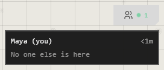

# Being in an atrium together

In an online or Google Drive atrium, everyone inside sees everyone else's
cursor as it moves, with their name beside it.

## Who's here

The people button at the top right shows how many are in the atrium. Press it
for the list, and how long each has been here.

The owner and the admins can **Kick** someone from this list. See
[People and roles](people-and-roles.md).

## Point at something

Press **K**, or **Laser pointer** on the quick bar. Hold the button and drag:
everyone sees the trail, which fades as it goes. It's never kept. Press **K**
again to put it down.

## Others' changes

What someone else changes reaches you when they save, not as they type.

If they save a change to a trace you've changed but not saved, theirs wins:
your unsaved change to it is replaced. Save often when you're working on the
same traces.

## Your cursor and theirs

In **User Preferences** > **People in the room**:

| Setting | What it does |
|---|---|
| **Hide My Name Tag** | No name above your own cursor |
| **Hide Others' Name Tags** | No names above other people's |
| **Hide Others' Cursors** | Other people's cursors don't show |
| **Hide My IP Address** | Connect through a relay, so others here can't see your IP address |

Your cursor's colour is on your Profile, or in **User Preferences** > **Profile**.

## Good to know

- Cursors and lasers go straight between you and the others where they can, which is why they can see your IP address unless you hide it.
- With **Hide My IP Address** on and the relay unavailable, your cursor reaches others every few seconds instead.
- A browser or desktop atrium has no one else in it.

## Related

- [Sharing an atrium](sharing.md): letting people in.
- [People and roles](people-and-roles.md): what each person can do, kicking and blocking.
- [Undo and saving](../arranging/undo-and-saving.md): when your changes reach the others.
