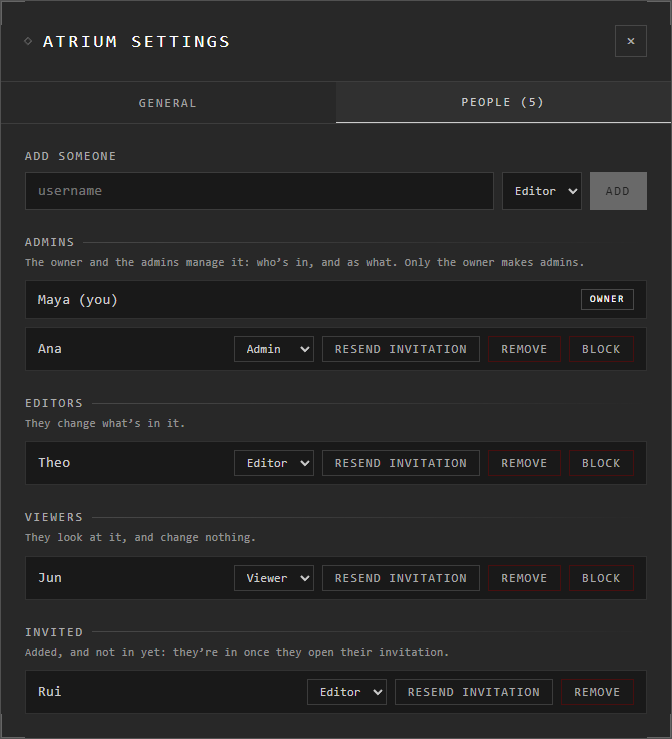

# People and roles

An online or Google Drive atrium has people in it, each with a role. The owner
and the admins manage them in **Menu** > **Atrium Settings** > **People**, or
from the atrium's card under **Atriums** > **Settings**.

A browser or desktop atrium is yours alone: no one else can reach it.

## The roles

| Role | Can |
|---|---|
| **Owner** | Everything: make admins, make the atrium public, choose its picture |
| **Admin** | Add, remove and block people, change their roles (not other admins'), rename the atrium, bring back deleted traces |
| **Editor** | Change what's in it |
| **Viewer** | Look at it, and change nothing |

Each atrium has one owner: whoever made it.

## Manage people

| You want | Do this |
|---|---|
| Add someone | Type their username under **Add someone**, choose **Editor** or **Viewer**, press **Add** |
| Change a role | Choose it in the list beside their name |
| Make someone an admin | Choose **Admin** beside their name (owner only) |
| Send their invitation again | **Resend invitation** |
| Take someone out | **Remove** |
| Take someone out for good | **Block**: they can't join again, nor ask to |

Each change is made at once: there's nothing to save.

Someone added finds the invitation under **Atriums** > **Shared with you**.
Until they open it, they're listed under **Invited**.

In a Google Drive atrium, making someone an admin asks for the Google address
they use with the Atrium: Drive shares the member list with it.

## Someone asks to join

Anyone with the atrium's link who isn't in it can press **Ask to be let in**.
The owner and the admins see it the next time they open the atrium:

> **Ana asks to join this atrium** · **Let in** · **Not now**

**Let in** adds them as an editor. They press **Join** again to go in.

## Who's here now

The people button at the top right shows how many are in the atrium now.
Press it for the list, and how long each has been there. The owner and the
admins see **Kick** beside each person, and are asked which:

| Choose | What it does |
|---|---|
| **Kick** | Puts them out of the atrium now. They stay on its list of people and can come back |
| **Kick + Blacklist** | Puts them out and blocks them, as **Block** in **People** does |

## Good to know

- Someone removed is told so, and the atrium closes for them. They can ask to be let in again.
- Someone blocked is told "its owner blocked you", and can't open it.
- Only the owner can make or unmake admins.
- A viewer of a public atrium is anyone who opens it; they never appear in **People**. See [Public atriums](public-atriums.md).

## Related

- [Sharing an atrium](sharing.md): the invite link, and how people find their invitation.
- [Google Drive atriums](drive-atriums.md): members, encryption, bringing back deleted traces.
- [Public atriums](public-atriums.md): letting anyone look, while only members change it.
- [Where atriums live](../getting-started/where-atriums-live.md): which atriums can have people in them.
