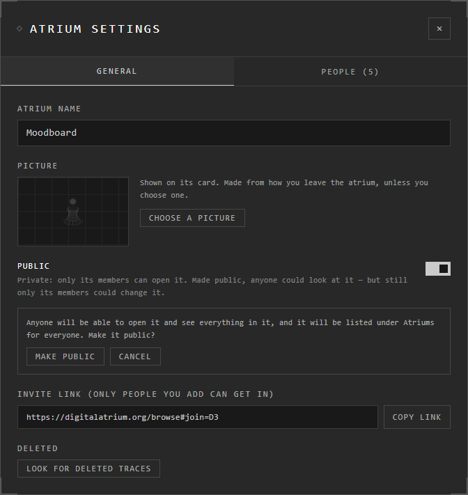

# Public atriums

A public atrium can be opened by anyone, guests too, and is listed under
**Atriums** > **Public atriums** for everyone. Only its members can change it:
everyone else can look, and nothing more.

An online or Google Drive atrium can be made public. A browser or desktop
atrium can't: no one else can reach it.

## Make one public

Only the owner can.

1. **Menu** > **Atrium Settings** > **General**.
2. Turn on **Public**.
3. You're asked first. Press **Make public**.

To make it private again, turn **Public** off. It's private at once: whoever
looked at it while it was public can't see anything new.

## Find public atriums

Open **Atriums** and go down to **Public atriums**. Search by name in the box
at the top. Press **Enter** on a card to look inside.

Someone else's public atrium shows **View only** on its card and at the top
of the screen once you're in. You can move around and zoom, but not change
anything.

## Report one

If a public atrium breaks the terms of use, report it: press the flag at the
top right inside it, or **Report atrium** in its card's **⋯** menu. Choose why,
add what's wrong if you like, and send. Every report is read.

## Good to know

- Public is all or nothing: anyone can see everything in it.
- Its people and their roles don't change: members still edit, everyone else looks. See [People and roles](people-and-roles.md).
- No account is needed to look at a public atrium.
- Your own atriums never show the report flag.

## Related

- [People and roles](people-and-roles.md): who can change it.
- [Sharing an atrium](sharing.md): letting chosen people in, rather than everyone.
- [Where atriums live](../getting-started/where-atriums-live.md): which atriums can be public.
- [Report a problem or suggest a feature](../help-and-support/report-or-suggest.md): reporting something that isn't an atrium.
